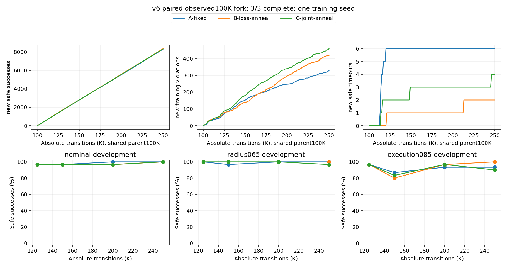
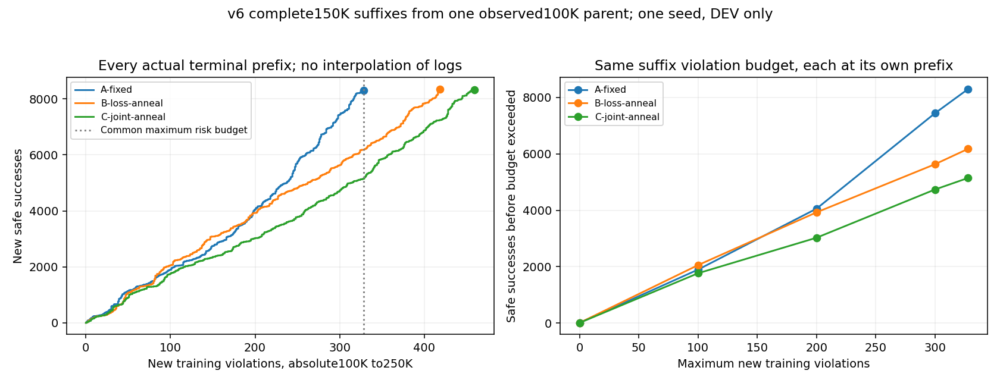
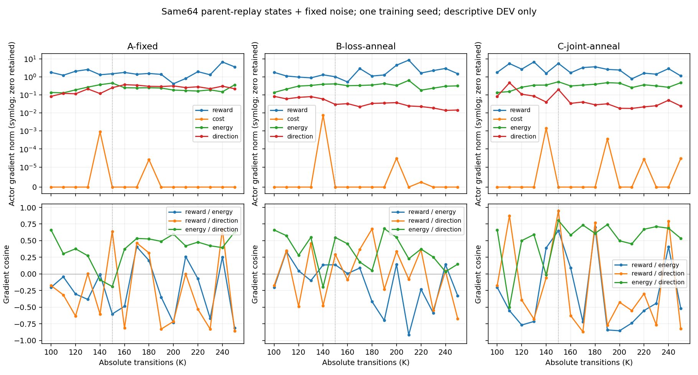

# v6完整开发审查：终点执行恢复，但训练安全收益未同时保持

2026-11-16 07:55 UTC（北京时间15:55）。三分支全部到固定绝对250K，新增科学训练精确450000步；
预定12个开发节点、36个条件表、1080执行回合与48条固定梯度探针全部齐备。
本轮有限开发与分析已完成，**同时改善训练安全和执行鲁棒性的研究目标尚未解决**。
没有启动剩余2.25M确认，没有打开独立测试、使用5080、连接实机或发送邮件。

## 1. 主要结论与决策

只退火附加方向loss的B在固定250K达到90/90安全成功，固定A为88/90；
B救回A的两个执行扰动失败回合，说明这种后期调度有积极的执行结果。
但B新增训练违规比A高27.4%，在相同违规预算下也没有保持A的后期训练收益，
所以不能宣布“安全与任务性能已经兼顾”、总体Pareto改进或跨seed有效。

C的温和联合退火终点只有86/90，包含2次安全距离违规和2次安全超时，
新增训练违规又比A高39.9%。本轮没有支持额外放松rho的实用收益。
C存在A100→4080硬件交接，不能把B/C差异全部因果归于rho；但不能因此删掉C或补跑挑结果。

本轮不强行选一个“全面更好”的新版本，不自动启动确认。
B保留为**执行优先的候选**，A保留为**训练安全优先的参考**，C不采用为当前优先候选；
候选身份不等于正式确认配置冻结。若下一步必须优先验证执行恢复，优先B而不是C；
若目标仍是保持训练安全收益，则当前退火方案没有达标，不能悄悄降低目标。
尚未注册或执行额外共同开发验证：它不能弥补已经观测到的训练违规增加，
目前不再为追求更好开发分数追加回合。后续具体修改或确认需另行明确，而不是让空闲GPU自动开新实验。

## 2. 同预算固定终点与完整曲线

以下均为同一个看过结果的Normal-shrink-dir／2028原生100K完整父状态分叉，
不是三个独立训练seed。三个条件复用同30个布局，90回合不是90个独立布局；
开发集被反复使用，零观测违规不等于真实零风险或独立泛化保证。

| 固定250K条件 | A固定：成功／违规／安全超时 | B仅loss退火 | C联合退火 |
|---|---:|---:|---:|
| nominal |30／0／0|30／0／0|30／0／0|
| radius065 |30／0／0|30／0／0|29／1／0|
| execution085 |28／2／0|30／0／0|27／1／2|
| 合计90执行回合 |88／2／0|90／0／0|86／2／2|

| 绝对节点 | A成功／违规／超时 | B成功／违规／超时 | C成功／违规／超时 |
|---|---:|---:|---:|
|125K|88／2／0|88／2／0|88／2／0|
|150K|84／6／0|83／7／0|84／6／0|
|200K|88／2／0|88／2／0|88／2／0|
|250K|88／2／0|90／0／0|86／2／2|

B不是在150K立刻改善，而是在后续训练至250K才优于A；不能只选250K而隐藏150K的回落。
C在200K恢复、250K再回落，证明单次恢复不能替代终点持续性。
旧Iso／Metric150K不作为本轮250K同预算对照，也不将旧PointGoal独立测试用于选择新版本。

[逐条件表](analysis/development_evaluations.csv)、[逐布局配对](analysis/paired_development_outcomes.csv)、
[全部配对不一致计数](analysis/paired_development_discordance.csv)。
原始每回合和全部实际控制细节在`development/<arm>/evaluation_<step>.json`，未剔除困难布局。

## 3. 新增训练后缀与完整历史分开

| 方法 | 新增150K成功 | 新增违规 | 新增安全超时 | 含共同前缀成功／违规／超时 |
|---|---:|---:|---:|---:|
| A固定 |8300|328|6|10334／601／502|
| B仅loss退火 |8351|418|2|10385／691／498|
| C联合退火 |8316|459|4|10350／732／500|

三组共同前缀2034成功／273违规／496超时，不在450K中重复记三次。
B相对A只多51成功（0.6%）、但多90违规（27.4%）；C多16成功（0.2%）、多131违规（39.9%）。
这种安全代价不应由最终90/90掩盖。

| 新增区间（绝对步） | A成功／违规／超时 | B成功／违规／超时 | C成功／违规／超时 |
|---|---:|---:|---:|
|100K—125K|1390／73／6|1410／79／1|1395／87／2|
|125K—150K|1395／79／0|1381／60／0|1392／94／1|
|150K—200K|2736／95／0|2765／156／0|2755／159／0|
|200K—250K|2779／81／0|2795／123／1|2774／119／1|

B退火期间前50K比A少13次违规，但之后100K比A多103次；不是长期保持低违规。
逐条闭合gzip统计100001—250000连续真实控制，计数与收据及父前缀一致，不由千步日志插值。
继承的两个未完父回合按实际终止事件计入后缀并注明父长度；
预算末A有2个、B有1个、C有2个已执行但未终止回合，单独保留，不当作失败。

## 4. 相同新增违规预算的精确前沿

每行取各方法累计违规不超过给定上限的最后真实终止事件，
其对应步数不同、均不超过新增150K，不是同时间点统计，也不表示因果支配。

| 新增违规上限 | A安全成功 | B安全成功 | C安全成功 |
|---:|---:|---:|---:|
|0|11|11|11|
|100|1898|2057|1768|
|200|4057|3927|3027|
|300|7441|5633|4737|
|328|8300|6180|5147|

328是三个完整后缀的最小最终违规数。该共同上限下A比B多34.3%成功，
但上限100时B更好，因此也不能声称A全程支配B。

[三臂全部精确前缀与来源SHA](analysis/three_arm_exact_suffix_comparison.json)，
[A](analysis/A-fixed-exact-suffix.json)、[B](analysis/B-loss-anneal-exact-suffix.json)、
[C](analysis/C-joint-anneal-exact-suffix.json)。分析零新仿真、零新训练。

## 5. 实际执行失败：毫米级边界与C的两个超时

固定250K所有安全违规控制：

| 分支／条件 | 布局 | 第几个实际控制 | 最小间距（毫米） | 距15毫米缺口 | 保护连杆 |
|---|---:|---:|---:|---:|---:|
| A／execution085 |7100028|4|14.651|0.349|8|
| A／execution085 |7100035|15|14.732|0.268|9|
| C／radius065 |7100037|17|14.765|0.235|8|
| C／execution085 |7100028|4|14.593|0.407|8|

这些是安全距离违规而非穿透碰撞，但不能因为缺口小就忽略或删布局。
B救回A两个失败，是配对开发上的2个改善，不是统计显著性或跨seed结论。
C在execution085布局7100038／7100040运行到100控制安全超时，
整回合最小距离分别28.681／24.907毫米，最终距目标142.985／123.905毫米；
最后动作仍有约5.201／4.652毫米TCP位移、任务进展为负，不能简单叫“完全不动”或安全违规。
所有失败/超时的raw与executed动作、实际位移、区间全保护连杆最小间距、任务进展均保留。

全12节点共35次实际违规控制，[完整严重程度表](analysis/actual_failure_severity.csv)保留全部，
不只公布终点。[配对分析收据](analysis/paired_development_receipt.json)显示1080完整执行回合。
execution085只在动作生成后乘.85，没有已知尺度补偿、额外候选动作或反事实仿真。

## 6. 梯度与归一化诊断：改变压力，不证明根因

同一父replay64状态和同一noise，每绝对10K一次，三组各16条，全部48条已保留。
probe SHA为`defdf465bfeb1a8d313906b4d3a3de569039ac1329d6ba0b7ccf7e5b2d36cec6`。
诊断不写优化器/.grad、不扰动训练RNG；零成本梯度夹角记null。

| 固定探针250K | A | B | C |
|---|---:|---:|---:|
| 任务梯度模长 |3.55072|1.48598|1.11697|
| 成本梯度模长 |0|0|0.00002989|
| 加权能量梯度模长 |0.35909|0.31441|0.47061|
| 加权方向梯度模长 |0.21752|0.01437|0.02390|
| 方向分子 |0.009136|0.007758|0.018118|
| 停止梯度分母 |1.56244|1.42499|1.90313|
| alpha_E |0.001896|0.002386|0.002330|
| 探针energy |19.710|17.971|23.968|
| 探针clipping |5.99%|4.30%|7.16%|
| 任务／方向cosine |−0.857|−0.671|−0.826|

共同100K起点任务1.75714／能量0.13526／方向0.08253，alpha约.000647。
B后期方向压力确实明显减弱，但任务梯度也在变，不能用某一个相对比值证明因果。
全部探针分母最小值A1.194／B1.166／C1.185，未接近1e−6；
没有证据把本次回落直接归因于分母趋零的数值爆炸，也不能排除更一般的归一化尺度影响。
固定250K训练minibatch的高模型风险20%上V_N/V_T为A.783／B.809／C.844，
危险外向速度代理A.0728／B.1343／C.1602；三组访问/风险集合不同，不是相同真实危险状态的因果比较。
探针energy与训练minibatch energy不是同一输入，不混用数值。
没有同步改变学习率、分母、alpha规则、reward/cost或安全乘子来迎合结果。

[全部四项梯度／夹角／分子分母](analysis/gradient_diagnostics.csv)，
[所有千步训练指标](analysis/training_curve.csv)。

## 7. 执行闭合、预算与后续边界

原生完成收据：三组steps250000、new_transitions150000、learner248000、actor123500、
reward496000；每组均保留125K／150K／200K／250K开发评测。
同父状态显式fork没有弱化旧恢复保护；新续跑也只接纳同配置同源码的signal-safe完整断点。
科学源码始终冻结33d31709；本地后来新增报告、绘图和统计未覆盖服务器活科学代码。
启动前数值测试、一次8步工程探针、后缀微型测试和配对文件测试已记录在状态历史，
本次只执行必要的闭合轨迹统计与渲染，不重复旧科学实验或整套测试。

C在172598从A100安全断点转4080，只补77402步，最终收据和连续原轨迹已验证闭合；
原A100目录/断点仍保留。[迁移记录](operations/C-handoff-20261116.json)。
07:51两端实际`ps`确认所有本项目训练/队列PID均已退出，仅只读半小时观察器仍在。
4080队列completed；A100旧队列completed_with_failures是退休迁移注册未获本机终点收据，
不是C科学失败或自动重试。大文件留数据盘，4080约518GiB、A100约47GiB空闲，后者高于40GiB底线。

科学账本为已完成v5 .75M + 已完成v6 .45M + 未使用确认2.25M = 总上限3.45M。
额外8步工程探针单列，不混入450K。旧九组300K／2.7M确认入口已显式禁用，
新三方法×三fresh seeds×250K仅是剩余额度，不代表已获自动启动许可；没有新确认配置或最终测试打开。

若继续研究，最清楚的新问题是“为什么减弱后期方向loss改善执行，却增加训练违规”，
而不是再细扫固定rho或重跑PointGoal。现有梯度只支持有针对性的后续假设，
**本轮没有据此启动学习率衰减、分母改法、执行随机化或边界重采样**。

程序、配置、完整负面证据、图和本报告发布在`codex/paper-robot-gap-v2`／PR15，
不等于已合并main；本地`关键结果汇总_20261114/后期退火_v6`同步，不含大模型/replay/gzip。
新上传执行稿SHA与原稿一致，本轮是原450K的收尾，不是又执行450K。
