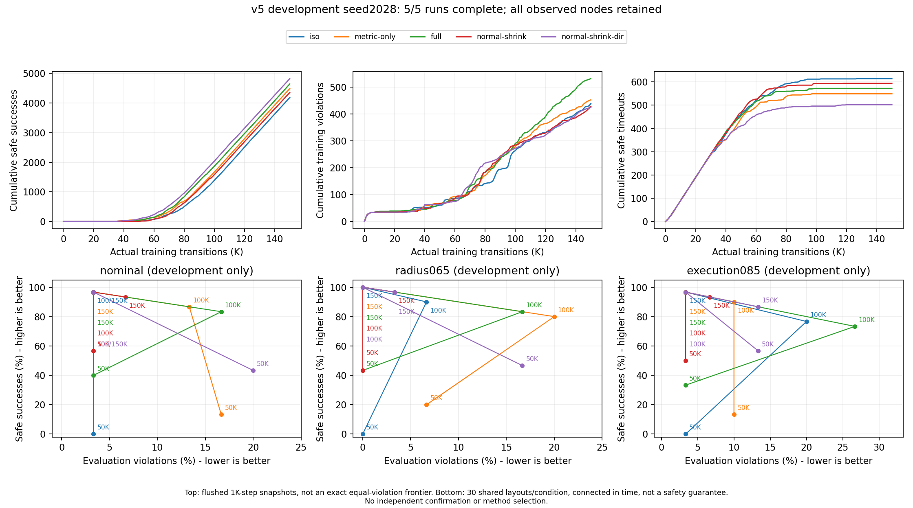

# v5五臂开发审查：训练探索改善，固定终点未通过，不进入确认

2026-11-15 11:37 UTC（北京时间19:37）。**有限开发实验已完成，找出经独立确认的有效方法这一研究目标未完成。**
单训练seed2028，五臂各150K，共750000真实训练步；三节点、三条件、各30回合，共1350开发回合。
三个条件配对复用同30布局，不是1350独立布局；没有运行独立测试、实机、5080或发送邮件。
8步工程探针单列，不计科学预算。没有科学提前停止或失败自动重试。

## 1. 固定150K终点和完整学习曲线必须同时看

| 版本 | 训练安全成功 | 训练违规 | 训练安全超时 | 最终开发成功／违规／超时（90回合） |
|---|---:|---:|---:|---:|
| Iso |4181|439|614|88／2／0|
| Metric-only |4483|453|549|88／2／0|
| Full |4641|532|572|88／2／0|
| Normal-shrink |4351|429|594|85／5／0|
| Normal-shrink-dir |4819|425|502|84／6／0|

加方向损失相对Metric：训练安全成功+7.5%、违规−6.2%、安全超时−8.6%；
相对Iso也是更多成功、更少违规。这个单seed训练探索收益是真实正向结果，不因终点差而删除。
纯Normal-shrink相对Metric：训练成功−2.9%、违规−5.3%，是任务—风险折中。
旧Full的训练违规比Metric多17.4%，最终开发分数相同，不支持它训练更安全。

| 版本 | 50K开发成功／违规／超时 | 100K开发成功／违规／超时 | 150K开发成功／违规／超时 |
|---|---:|---:|---:|
| Iso |0／2／88|79／9／2|88／2／0|
| Metric-only |14／10／66|77／13／0|88／2／0|
| Full |35／2／53|72／18／0|88／2／0|
| Normal-shrink |45／2／43|88／2／0|85／5／0|
| Normal-shrink-dir |44／15／31|88／2／0|84／6／0|

两个新版100K都好，固定150K都回落；不能选100K快照掩盖预定终点失败。
这也不是新版必然无效的统计证明：训练seed只有一个、布局30个；
但目前没有达到“任务不明显退化且风险改善”的确认入选依据，因此不能强行定型。

[逐条件完整表](analysis/development_evaluations.csv)、[所有千步日志](analysis/training_curve.csv)、
[原生运行表](analysis/training_inventory.csv)、[紧凑输入SHA](analysis/receipt.json)。

## 2. 真正相同累计违规预算：不是全程支配

五条闭合原轨迹按真实终止事件计算前缀，不用千步日志插值。
每行取累计违规不超过上限的最后终止事件；各方法在不同真实步数达到该点，均不超过150K。

| 累计违规上限 | Iso成功 | Metric成功 | Full成功 | Normal-shrink成功 | Normal-shrink-dir成功 |
|---:|---:|---:|---:|---:|---:|
|0|0|0|0|0|0|
|100|211|276|326|201|357|
|200|1106|867|1136|775|804|
|300|1935|1855|1969|1910|2481|
|400|3605|3419|3036|4008|4312|
|425|3957|4020|3226|4297|4819|

425为五臂最终违规最小值。该共同上限下，新dir比Metric多19.9%安全成功；
但上限200时它低于Iso／Metric／Full，不支持整个前沿全面支配。
这比单一最后累计数更精确，仍不能替代最终执行的安全收益。

## 3. 覆盖只是描述，不是多路线证据

每个固定窗口匹配五臂各自按时间最先出现的同数量成功：

| 窗口 | 各臂匹配成功数 | Iso网格 | Metric网格 | Full网格 | shrink网格 | shrink-dir网格 |
|---|---:|---:|---:|---:|---:|---:|
|0—50K|9|249|208|262|288|250|
|50—100K|1372|1105|1124|856|1037|1018|
|100—150K|2772|740|653|609|667|692|

世界坐标TCP网格20毫米、路径等弧长5毫米，布局访问分布不同，较大覆盖不自动表示更好或更安全。
没有接纳合法不同拓扑路线，没有证明多模态策略或跨布局泛化。
失败、超时、全体真实控制及预算末未完回合均保留；Full有1个未完回合，其余各2个，不当失败。
[五臂精确比较及全部前缀](analysis/five_arm_exact_trajectory_comparison.json)
包含原充分统计、所有终止事件前缀和对应脚本SHA，零新仿真／训练。

## 4. 为什么还不够：已核实事实与待证假设分开

1. **没有安全零风险目标。** 共享训练回合成本预算为0.1；首次违规即终止，成本0／1。
   后期安全乘子经常为0，150K时Metric和新dir均为0。
   训练平均预算不约束执行扰动条件下的少数危险布局，也没有要求风险持续趋零。
   这不是符号错误，也不能据此认定它导致相对回落；不在本轮中途修改共同对照。
2. **全局低余量误差不等于边界可靠。** 固定150K模型在各自原末10K动作上的几何EMA诊断如下。
   样本可能入训练、分布不同，不能解释为独立校准或各方法相同输入上的比较：

| 版本 | 全部RMSE（毫米） | 实际危险动作 | 均值误判安全 | 两头均判安全 |
|---|---:|---:|---:|---:|
| Iso |0.627|37|5|3|
| Metric-only |0.670|33|8|5|
| Full |0.673|39|8|8|
| Normal-shrink |0.647|43|9|8|
| Normal-shrink-dir |0.666|29|3|1|

   新dir该诊断反而较好，不支持把终点回落简单归因于余量模型整体更差。
   head分歧不是置信区间；该诊断不测采样器实际梯度、因果机制或执行扰动分布。
3. **代理损失改善不保证执行改善。** 新dir后期危险外向速度／限幅代理下降，最终评测仍回落。
   少数失败是毫米级安全距离不足，未发现简单的权重失活或符号反写；
   尚未证明是哪一种尾部／分布错配导致，也不删除共用难布局。
4. **同时变了噪声总量。** Normal-shrink不回补切向噪声，trace可以下降。
   即使训练有收益，也不能把它全部归因于固定熵预算下的方向分配，不能声称新安全定理。

五份[固定末10K诊断](margin_calibration/)含EMA和在线模型统计、模型／轨迹／脚本SHA。

## 5. 本轮决策和下一步边界

**本轮两个候选都不选入三seed确认，不消耗原预留2.7M去确认一个尚不符合入选依据的方法。**
没有确认配置、新独立seed文件、确认训练或独立测试结果。程序入口准备不代表效果完成。
完整负面结果、所有seeds／节点保留；不会换seed、延长当前150K、删布局或反复测试直到出现胜出。

若继续修改，较有针对性的假设是：方向约束适合作为训练探索偏置，但固定后期强度／几何使用
可能损害终点执行；可以另行登记一次固定时间表的退火方案，与同预算控制做有限开发比较。
这只是待验证假设，不是因果结论；同样可能失败。相比细扫更多固定lambda，它直接检验训练／执行分离问题。
**新的调度方法不属于原阶段B“冻结已选候选不再改法”的确认方案。**
因此应先明确是否重新分配未用预算及新的固定比较规则，得到用户方向后再开新任务，
不偷偷改注册、不把新开发叫独立确认，也不自动占满空闲GPU制造更多无依据实验。

## 6. 运行完成与发布范围

Full在A100103486步安全保存，完整状态转4080续至150K；
固定源码721bf6bb、同初始化、优化器／replay／RNG／环境／未完回合均保留，跨硬件不承诺位级等价。
11:34原PID3786655已不存在，原生完成收据及150K评测齐备；两主机观察器均报告无本项目训练进程。
A100旧队列completed_with_failures是原暂停迁移注册缺本机终点收据，不是丢失Full或自动科学重试；
[完整迁移记录](operations/full-handoff-20261115.json)与4080最终收据是续跑证据。
半小时只读观察器仍在，不会自动重启或追加任务；所有科学训练队列均已结束。
大检查点／replay／原轨迹保留两端数据盘，GitHub和本地镜像仅程序、报告、图和充分统计。
发布分支`codex/paper-robot-gap-v2`／PR15，不代表合并main。
