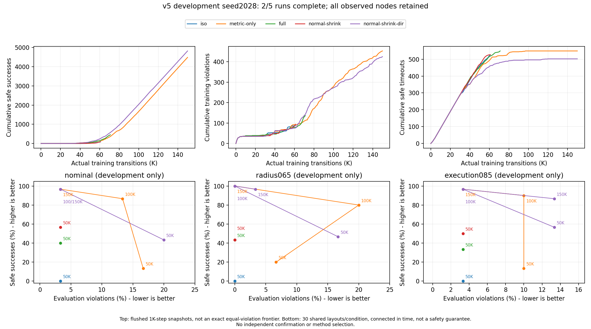

# 方法改进v5：五臂开发已完成，固定终点未通过，不进入确认

更新2026-11-15 11:37 UTC（北京时间19:37）。750K开发及诊断完成；研究目标尚未完成。

## 最新决策：5/5完成，两个候选均不选入三seed确认

Full已在4080原生续至150K，11:34确认原PID3786655退出、完成收据及全部评测齐备。
五臂各150K，总750000真实训练步，1350开发回合；五份闭合轨迹充分统计、
五份固定末10K诊断及完整共同违规预算比较均已完成，没有新仿真或训练来补好分数。

| 版本 | 150K开发成功／违规（90回合） | 训练成功／违规／安全超时 |
|---|---:|---:|
| Iso |88／2|4181／439／614|
| Metric-only |88／2|4483／453／549|
| Full |88／2|4641／532／572|
| Normal-shrink |85／5|4351／429／594|
| Normal-shrink-dir |84／6|4819／425／502|

新dir训练成功较Metric多7.5%、违规少6.2%，但两个新版终点评测均弱于控制；
100K好节点不能替代固定150K。共同违规上限425时五臂成功分别3957／4020／3226／4297／4819，
上限200时新dir仅804、低于Iso1106和Metric867，不能声称风险前沿全程支配。
全部原始节点、负面结果、失败／安全超时和未完回合保留；Full1个未完回合，其余各2个，不计失败。

[完整开发审查、曲线、风险前沿、诊断与后续边界](FINAL_DEVELOPMENT_REVIEW_ZH.md)。
本轮没有候选满足进入确认的依据，原预留2.7M未使用；未打开新独立测试、未建确认配置。
下一种方法修改需明确新的有限开发方案，不能用“确认”名义继续调参；在此之前不新增训练。
这不是研究目标已完成或暂停目标，只是本轮有限实验结束，需明确后续方向。
A100旧队列已退役、4080原队列已结束，两个半小时只读观察器仍在，不自动重启任务。
下一只读快照约12:04:32 UTC（北京时间20:04）；无需为了空闲GPU占用率启动未登记实验。
不使用5080、不连接实机、不发送邮件，大文件留数据盘。

下方全部为历史过程，旧的“运行中／估时／等待Full”不代表当前状态。

## 11:04检查与安全迁移：4/5完成，纯Normal-shrink终点也回落

4080两条原训练进程3755996／3755998已退出，原有限队列四项均完整收据、exit_code=0，
队列本身也已退出；全卡4%、560MiB时确认原共享槽已释放。
纯Normal-shrink从100K的88/90、2违规回落到150K的85/90、5违规；
**当前两个新版均未超过Iso和Metric的固定150K开发终点**。

| 固定150K开发结果 | 成功／违规／安全超时（90回合） | 训练成功／违规／安全超时 |
|---|---:|---:|
| Iso |88／2／0|4181／439／614|
| Metric-only |88／2／0|4483／453／549|
| Full |尚未完成，不能补位|尚未完成|
| Normal-shrink |85／5／0|4351／429／594|
| Normal-shrink-dir |84／6／0|4819／425／502|

纯Normal-shrink训练成功相对Metric少2.9%、违规少5.3%，是任务—风险折中，不是Pareto胜利。
加方向损失训练成功更多、违规更少的正向证据仍保留，但不能替代终点执行风险。
四条已闭合轨迹均已流式分析并核对原生收据，各有2个预算末未完回合；
四份末10K余量诊断均完成，只有紧凑JSON收回本地，零新训练／仿真控制。
Iso末10K实际危险37个，几何均值漏判5个；纯Normal-shrink危险43个，漏判9个。
训练分布各异且可能入样，不据此判定独立校准或因果解释。
完整五臂共同风险预算／覆盖比较仍等待Full，不用四臂冒充完成。

Full在A100原生PID1901123仍正常时，本项目专属SIGTERM只请求完成当前更新／评测边界保存。
实际在103486步写`interrupted_full.pt`，状态`stopped_at_safe_boundary`，
原进程已停止（原父队列待回收的僵尸状态），未触碰其他项目。
整个run从A100数据盘以SSH流传到4080此前不存在的run目录，无本地大文件中转；
两端断点SHA相同：`6c7633d58ac38b8ffa92d989f21559fb2b859ec5e9f71c455c0f5c7fa4b15da0`。
源码及模型构造字节相同，原150K预算、seed、优化器、replay、RNG、环境及未完回合都原生恢复。
只将工程显存比例上限从0.025改为0.10，不承诺跨硬件位级等价。

4080续跑PID3786655经`ps`确认存活，已实际更新到104000步／102000 learner updates；
不是只提交命令或复制模型。原A100前缀不删除，后续Full紧凑记录**只从4080收取**，
防止A100旧前缀覆盖新后缀。原A100队列可能将缺终点收据记为failed_not_restarted，
这是已退役的迁移注册，不当成新科学失败重试。
原始[迁移来源记录](operations/full-handoff-20261115.json)一并保留。

本阶段现在约704K/750K、4/5完成，仅Full余约46K；
参照4080既有共享吞吐粗估20—35分钟，尚没有充分的迁移后窗口精确估时。
若留A100原机，原103K节点尚约需1.4小时纯计算；本次迁移意在缩短尾程，不改方法。
下一半小时检查11:34:32 UTC（北京时间19:34），届时才确认是否完整完成。
剩余大文件仍只在数据盘，4080约486GiB、A100约76GiB空闲，均保留40GiB。
本轮结束前不启动三seed确认、不用5080、不连接实机、不发送邮件。

下方为完整保留的历史节点，最新运行状态以上述迁移后实查为准。

## 10:35半小时实查：614K/750K，纯Normal-shrink的100K评测改善但训练并非全面改善

原生`ps`确认三个原PID3755996、3755998、1901123仍在运行，
两个观察器最新快照10:34:32 UTC；没有重启、重试或增加任务。
收回Metric150K、Normal-shrink-dir150K、Iso113K、Normal-shrink114K、Full87K，
共614K/750K，仍2/5完成。五臂源码及初始化不变。

100K同预算节点如下；Full尚未到该节点，不用87K结果补位：

| 版本 | 开发成功／违规／安全超时（90回合） | 训练成功／违规／安全超时 |
|---|---:|---:|
| Iso |79／9／2|1388／264／612|
| Metric-only |77／13／0|1669／279／549|
| Full |尚未执行|尚未到100K|
| Normal-shrink |88／2／0|1579／285／593|
| Normal-shrink-dir |88／2／0|2034／273／496|

纯Normal-shrink开发评测优于两个对照，但训练成功少于Metric且违规略多；
不能把较好评测换算成探索全面改善。两个新版本该节点同为88/90，
但加方向损失版本150K已回落，纯Normal-shrink的150K仍未知。
目前仍只有单训练seed、复用的30开发布局，未执行独立确认，不选择好节点替代终点。

最近10K：4080 Iso29.62、Normal-shrink29.86步/秒，各余37K／36K，
预计纯计算约21／20分钟；A100约9.06步/秒，余63K，若留原机约1.9小时纯计算。
下一检查约11:04:32 UTC（北京时间19:04），届时若4080原进程确实结束，
再按原生安全边界迁移Full，有望把本阶段尾程压到约1小时量级；尚未实施，不保证完成时刻。
不迁移则本阶段约还需2—2.5小时，不含确认训练。
4080全卡95%、约1.2GiB显存、数据盘487GiB空闲；A100全卡100%／100%、数据盘76GiB空闲。
继续共享资源、不触碰其他项目，不用5080，不增加实验预算。

原始新评测、完整曲线与图已更新；下方为此前历史记录，最新进度以上述10:35为准。

## 10:05半小时实查：493K/750K，五臂50K节点已齐，不能只看较好的评测

原生`ps`确认4080的Normal-shrink PID3755996、Iso PID3755998及
A100 Full PID1901123仍在运行；两个队列与半小时观察器也仍存活。
观察器最新原生快照10:04:32 UTC，下一次约10:34:32 UTC（北京时间18:34）。
收回步数150K+150K+71K+61K+61K=493K/750K，2/5完成。
只同步紧凑记录，未重启、重试、改预算或触碰其他项目。

全部五臂相同50K节点如下；三条件重复配对30布局，不是90个独立布局：

| 版本 | 开发评测成功／违规／安全超时（90回合） | 训练成功／违规／安全超时 |
|---|---:|---:|
| Iso |0／2／88|16／61／461|
| Metric-only |14／10／66|50／68／442|
| Full |35／2／53|41／65／455|
| Normal-shrink |45／2／43|9／68／468|
| Normal-shrink-dir |44／15／31|86／63／411|

纯Normal-shrink在该早期开发评测更好，但训练累计成功反而最低；
它不证明训练探索更好、最终胜出或跨seed有效。
加方向损失版本早期训练成功最多，却有更多评测违规；它的150K回落仍完整保留。
五臂全曲线与逐条件原始记录均更新，不用早期优势替代固定150K终点。

最近10K真实训练吞吐：4080 Iso29.61、Normal-shrink29.80步/秒，
A100 Full9.10步/秒，含该窗口内实际系统开销，不用warmup速度估时。
4080当前两项各余89K，纯计算约50分钟；A100余79K，纯计算约2.4小时。
若不迁移，整个开发阶段暂估还需2.5—3小时；不包含尚未启动的确认阶段。
待4080两个原槽真正释放后，才评估把A100本项目Full在原生安全边界暂停并迁移完整状态，
有望省约1小时；**当前尚未暂停或迁移，不能把节省当成已实现**。
跨硬件续跑保持原预算、模型、优化器、replay、RNG和轨迹来源，但不承诺位级相同。

4080全卡94%利用率、约1.2GiB显存，数据盘约487GiB空闲；
A100两卡即时97%／100%，仍与其他项目共享，数据盘约76GiB空闲，保留40GiB底线。
显存空闲不是计算空闲，不为提高显示占用量而重复启动科学任务。
所有大检查点和原轨迹继续只留数据盘，不使用5080、不连接实机、不发送邮件。

下方09:35、09:05等记录为历史节点；最新进度及估时以上述10:05实查为准。

独立确认闭合入口已补齐，三个极小合成测试通过，未运行真实测试、未新增训练。
入口要求全部九个固定300K策略与几何模型先冻结，才读取新seed承诺文件。
后续2700执行回合会配对复用100个新布局，不按2700个独立布局解释。
当前仍没有确认配置、新测试seed文件或方法选择；程序准备不替代效果证据。

## 固定末10K安全余量诊断：有漏判，但没有证据把终点评测回落归因于模型整体变差

按预先登记的诊断规则，两个已完成版本均使用原150K检查点，
回放既有140001—150000步的全部10000个实际动作，重建动作前观测；
只做冻结CPU前向，不训练、不生成新动作、不增加仿真控制。
其余三臂尚未完成，没有把缺少的诊断结果当零或跳过它们。

| 几何EMA模型，原末10K动作 | Metric-only | Normal-shrink-dir |
|---|---:|---:|
| 全部动作RMSE（毫米） |0.670|0.666|
| 实际违规动作数 |33|29|
| 实际违规却均值判安全 |8/33|3/29|
| 实际违规且两个头均判安全 |5/33|1/29|
| 实际违规子集RMSE（毫米） |0.962|0.755|
| 实际边界±5毫米内动作数 |201|164|

原始[Metric诊断](margin_calibration/metric-only-seed2028.json)与
[新版诊断](margin_calibration/normal-shrink-dir-seed2028.json)含在线模型、分组误差、
双头分歧和检查点／轨迹／脚本SHA。
约98%的样本处在安全内部，不能凭低全局误差宣布危险尾部或梯度可靠。
不过这批记录中，新版的危险漏判反而更少，**不支持“新版终点更差是因为余量模型整体更差”**。
不同策略实际访问分布不同，而且这些是可能入样的训练数据，不是相同输入上的独立测试；
两模型头分歧不是校准置信区间，不能据此声称泛化风险已被控制。
该结果也不直接检验采样过程中的梯度方向、实际风险权重或因果机制。
结论仍需等待全部五臂固定150K结果，不挑100K好节点，不据此临时改正在运行的方法。

另一个已核实的限制来自共享约束本身，而不是新损失符号：
`ArmLearner.cost_limit=0.1`，每个回合首次违规即终止，
终止成本为0／1，因此该EMA约束允许非零的训练回合违规率。
安全乘子按`max(0, multiplier+0.05*(episode_cost_ema-0.1))`更新。
100K—150K共51个千步快照，Metric有28个、新版有38个安全乘子恰为0；
固定150K两个版本的安全乘子均为0。
最后50K实际终止回合中，Metric违规174/2988（5.82%），新版152/2943（5.16%）。
这说明当前共享目标没有要求把违规不断压向零，后期额外成本项经常没有梯度压力；
不说明更新错误，也不能证明它导致新版相对对照回落。
训练EMA约束不是执行扰动下的尾部保证，日志中replay状态平均`policy_cost`
也不能直接当成从初始布局出发的整回合违规概率。
本轮五臂预算与约束保持不变；任何后续预算修改都需要新的明确共同对照，不能中途只改新方法。

## 当前150K结果：必须保留回落，不能用100K代替固定终点

09:35实际核对：首批两个150K原生收据已生成，原PID3719844／3719846已退出，
原有限队列确认exit_code=0；没有因观测超时重启或重复任何训练／评测。
Iso和Normal-shrink已接续，PID3755998／3755996经`ps`确认在运行；A100 Full原PID1901123继续。
五臂都已启动，收回紧凑记录为150K+150K+55K+10K+10K=375000/750000，2/5完成。
五臂网络初始化SHA相同；科学源码仍为原`721bf6bb`，没有偷偷改变学习设置。

| 150K固定开发终点 | Metric-only安全成功／违规 | Normal-shrink-dir安全成功／违规 |
|---|---:|---:|
| nominal |29/30；1/30|29/30；1/30|
| radius065 |30/30；0/30|29/30；1/30|
| execution085 |29/30；1/30|26/30；4/30|
| 三条件共90回合 |88成功／2违规／0安全超时|84成功／6违规／0安全超时|

新版本100K曾88/90、2违规，150K回落为84/90、6违规，尤其execution085变差。
Metric-only反而从100K的77/90改善到88/90。**当前不支持新版本最终执行风险更好，
不能挑100K好节点作为本轮固定终点，更不能宣布方法已有效定型。**
这仍是单训练seed、已观察开发集；少量回合差异不作显著性或泛化保证。

完整相同150K交互预算的训练累计结果：

| 版本 | 安全成功 | 违规 | 安全超时 |
|---|---:|---:|---:|
| Metric-only |4483|453|549|
| Normal-shrink-dir |4819|425|502|

新版本训练成功多7.5%、违规少6.2%，训练探索和终点执行的结论不能互相代替。
两个实际闭合轨迹已在原数据盘流式分析、与原生收据逐项相符；
只收回充分统计JSON，没有传输大轨迹、replay或模型，没有新仿真控制／训练。
原始[Metric充分统计](trajectory_summaries/metric-only-seed2028.json)、
[新版充分统计](trajectory_summaries/normal-shrink-dir-seed2028.json)保留每个终止事件与所有窗口前缀。
两份分析脚本SHA、公共分析SHA相同；各有2个预算末未完回合，不把它们算失败。

目前仅两个完整版本的精确共同违规预算如下；不是五臂最终比较：

| 允许累计违规上限 | Metric-only已获安全成功 | 新版已获安全成功 |
|---:|---:|---:|
|0|0|0|
|100|276|357|
|200|867|804|
|300|1855|2481|
|400|3419|4312|
|425|4020|4819|

每行取真实终止事件中累计违规≤上限的最后一个事件，没有1000步插值。
共同上限425时，Metric在141675步已获4020成功，新版在149998步4819，后者多19.9%；
**上限200时新版反而更少**，因此不宣称整个风险预算前沿全面支配。
两者50K窗口匹配最早50条成功，网格覆盖Metric497／新版623；
50—100K匹配1619条时1141／1024；100—150K匹配2785条时653／692。
早期覆盖更广、中期更窄，仍不构成合法路线、拓扑或泛化证据。
全部五臂完整前沿／匹配覆盖必须等其余三项完成后再计算，不以该二臂局部比较冒充完成。

A100 Full仅到55K，但它的50K原始90回合也已完整上传（35成功、2违规、53安全超时），
不因任务较慢或不同硬件共享吞吐而提前停它。4080仍使用两个共享槽，下一批无额外启动预算。
当前阶段尚余约375K交互；按A100既有约9步/秒计算，本项仍约3小时，
整个开发阶段暂估还有3—4.5小时，不含确认阶段，允许共享负载变化时顺延。
下次半小时检查约10:04:32 UTC（北京时间18:04）。
下面100K正向节点与50K负面节点保留为学习曲线，不再作为“当前胜出”的标题结论。

## 100K历史开发比较：正向节点，不替代150K终点

09:05实际`ps`确认三个原生训练进程及两个观察器仍在运行；
09:04:32半小时快照已更新，无重启／预算变化。
收回记录为两个4080版本各110K、A100 Full40K，共260000/750000步，0/5完成。
Iso和Normal-shrink仍为原有限队列待启动项，没有被遗漏或另换seed。

| 100K开发条件 | Metric-only安全成功／违规 | Normal-shrink-dir安全成功／违规 |
|---|---:|---:|
| nominal |26/30；4/30|29/30；1/30|
| radius065 |24/30；6/30|30/30；0/30|
| execution085 |27/30；3/30|29/30；1/30|
| 三条件共90回合 |77成功／13违规／0安全超时|88成功／2违规／0安全超时|

相同100K训练交互预算：

| 版本 | 训练安全成功 | 训练违规 | 安全超时 |
|---|---:|---:|---:|
| Metric-only |1669|279|549|
| Normal-shrink-dir |2034|273|496|

该节点新版本更多安全成功、较少评测违规，且训练违规稍低，是比50K更好的开发证据。
仍为一个开发训练seed；三个条件复用同30布局，不是90个独立布局或跨seed确认。
完整曲线中约60K—100K区间新版累计违规一度**高于**Metric-only，
不能用100K的轻微反超声称整个训练过程始终更安全，也不声称已完成精确共同违规预算比较。
50K时新版评测违规更高的负面节点完整保留在下方、原始JSON和图中，不删去或替换。

上排是每1000步刷新的原生训练计数，不是精确同违规前沿；
下排按时间连接50K和100K已观察开发节点，不插值制造新策略。
未启动者明确列在图注；A100 Full只到40K，没有拿不同终点作胜负比较。
完整[所有开发条件表](analysis/development_evaluations.csv)、[训练曲线](analysis/training_curve.csv)及
[全部输入SHA](analysis/receipt.json)均更新；原始逐回合及轨迹位置保留。

最近10000步4080各约28.5—28.8步/秒，当前两项各剩约23分钟计算；
A100约9.1步/秒，本项剩约3.4小时计算。考虑其余两项及半小时调度，
整个开发阶段暂估还需3.5—5小时，不含尚未启动的确认阶段；共享负载变化可能顺延。
4080其他约10.9GiB占用已释放，当前全卡约1.2GiB／91%，原6GiB准入不再构成当下障碍，
因此没有修改队列或暂停任何外部项目。A100两卡全卡100%仍主要有其他项目共享负载。
下次半小时检查约09:34:32 UTC（北京时间17:34），届时确认首批是否完成并接续原两项。

三seed300K确认入口已准备、8项针对性检查用时约1秒通过；
但没有可执行的确认冻结配置、未选择方法、未启动确认训练，也没有打开新测试布局。
服务器本轮仍运行原`721bf6bb`冻结源码，没有用程序准备替换科学效果证据。

## 50K历史开发节点（包含负面结果，完整保留）

08:35实际`ps`确认三个原PID仍在运行，观察器08:34:32的第二次快照已更新；
没有把过期状态文件当活进程，也没有重启科学任务。
收回最新紧凑记录为60000／60000／24000，共144000/750000实际训练步；0/5完成。
两个4080版本已执行50K开发节点，每条件30回合：

| 条件 | Metric-only安全成功／违规 | Normal-shrink-dir安全成功／违规 |
|---|---:|---:|
| nominal |4/30；5/30|13/30；6/30|
| radius065 |6/30；2/30|14/30；5/30|
| execution085 |4/30；3/30|17/30；4/30|
| 三条件共90回合 |14成功／10违规／66安全超时|44成功／15违规／31安全超时|

这是同一开发训练seed、同一开发布局和采样seed的早期结果；
三条件重复使用相同30布局，不把90回合误当90个完全独立布局，也不作跨seed显著性结论。
新版本任务推进更快，但评测违规更多，**不是终点Pareto胜利或整体安全优越性的证明**。
必须等100K、150K及另外三个版本齐备后再选择，不据这个节点调参或提前停训练。

恰好相同50K训练预算的原生累计记录：

| 版本 | 训练安全成功 | 训练违规 | 安全超时 |
|---|---:|---:|---:|
| Metric-only |50|68|442|
| Normal-shrink-dir |86|63|411|

该节点新版本训练期同时更多成功、较少违规，是值得继续检验的线索；
不能代替完整曲线、共同违规预算和固定终点结论。旧Full尚24K，Iso和无dir新版本仍排队，
不能拿这两个已评测版本代替五臂整体。
原始逐回合与轨迹位置在`development/*/evaluation_50000.json`，
[全部条件表](analysis/development_evaluations.csv)、[训练曲线](analysis/training_curve.csv)与
[来源SHA收据](analysis/receipt.json)均一并更新，不只发布较好的条件。

最近8000步4080各约27.3步/秒，A100约9.0步/秒；不使用random warmup速度估时。
按当前速度本阶段纯计算还约4小时，考虑共享负载和半小时调度，暂估4—6小时；
这不包含尚未启动的三seed确认阶段，也不是截止时间保证。
4080现在有其他项目约10.9GiB显存占用，全卡99%不能算成本实验独占，两个本实验进程各338MiB。
原队列新任务准入6GiB可能在本轮释放槽后过严：若届时真实等待，
只在确认本轮孩子已退出后接续原两个未启动任务、合理降低准入，不重复训练或干扰其他项目。
数据盘仍有4080约495GiB、A100约76GiB，符合40GiB余量要求。
下次半小时快照约09:04:32 UTC（北京时间17:04）。

## 旧实验完成状态

上一轮获授权非实机训练／评测包完成，最终程序、报告、紧凑原始证据已在
`cfe6814225f9fce23d029d66787782c2de694168`推送PR15，未合并main。
本地关键结果汇总也已核对存在。
详见[旧最终汇总](../nonhardware_v4/FINAL_SUMMARY_ZH.md)与
[明确的完成边界](../nonhardware_v4/COMPLETION_AUDIT_ZH.md)。
5080离线部署计时按用户指令暂缓；有效多路线比较和E14因果消融没有完成、也未声称完成。
当前新的“改一个有效方法”目标仍在推进，不能因为旧实验结束就称全部研究问题解决。

## 新实验已执行的事实

- 方法／有限预算计划在训练启动前注册并推送：`721bf6bbdba5943c800498557e9b0203f73cc3bf`。
- 6项针对性数值／旧对照一致性测试通过；4080实际8步启动检查通过，单列工程预算。
  本机缺panda_gym只影响仿真模块导入，已做惰性依赖隔离；服务器沿用原环境，不安装新依赖。
- 08:03 UTC启动三个科学进程，均已经有真实训练／梯度更新，不只是队列文件：

| 服务器 | 版本 | 原生PID | 队列 |
|---|---|---:|---|
| 4080 | Normal-shrink-dir |3719844|运行|
| 4080 | Metric-only |3719846|运行|
| A100 GPU0 | 旧Full新seed对照 |1901123|运行|
| 4080 | Normal-shrink |未启动|后续有限队列|
| 4080 | Iso |未启动|后续有限队列|

初始08:06收回紧凑快照共有26000实际记录步：11000／11000／4000，0/5完成，
尚未到任何50K开发评测节点，**不能汇报新版本成功率、优越性或已选出有效方法**。
三个已启动版本网络初始化SHA完全相同：
`3a81b7f0b88eff6ae128a273c79ecbd5779d8ecbb89d1d12ba4c52186abee4cf`。
全部五臂在[运行表](analysis/training_inventory.csv)列出，包括未启动者；
[记录来源与SHA](analysis/receipt.json)区分已完成数与预算，未运行独立测试。

## 08:06启动时共享资源记录（历史，不替代上方最新检查）

08:04:32原生观察器记录4080利用率85%；两个新进程各332MiB，GPU仍与桌面共享。
A100 GPU0利用率100%为全卡总量，主要有其他项目占用；不是声称本实验独占／吃满A100。
本实验A100进程只使用小共享槽，其他项目未被停止。
大检查点、replay、逐步gzip轨迹只写两台数据盘，A100约76GiB空闲、4080约510GiB，保留40GiB余量。

两个半小时只读观察器已实际启动：A100 PID1901245、4080 PID3720154，
最近原生记录08:04:32 UTC，下一次约08:34:32 UTC（北京时间16:34）。
有限队列也每1800秒检查完成收据并接续预先注册的任务，不因科学结果差重跑，不启动确认阶段。
首次稳定训练／50K开发节点后再估算剩余时间，不把random warmup吞吐当持续训练速度。
目前不使用5080、不连接机器人、不发送邮件。

新预算、方法改变和待验证假设见[开发计划](PLAN_ZH.md)。
