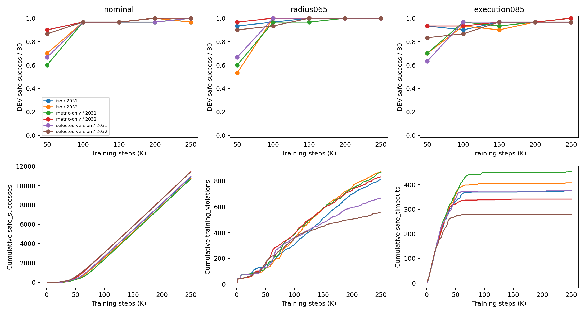

# SAFEFLOW v10：关键结果分析包

六条从头训练（3方法×2新seed×250K，共150万步）和一次1800回合独立评测全部完成。
固定250K终点，所有方法同样使用已有target Actor；不根据独立结果重选模型或调参。

| 方法 | 完整训练违规均值↓ | 训练安全成功均值↑ | 训练超时均值↓ | 独立安全成功/600↑ |
|---|---:|---:|---:|---:|
| Iso |845|10821.5|391|587（97.83%）|
| Metric-only |851|11081|397|589（98.17%）|
| P5选定版 |614|11204.5|327|587（97.83%）|

P5训练违规比Iso减少27.3%、比Metric-only减少27.8%，两个新seed方向一致；最终独立任务表现接近对照。
不宣称所有条件领先、统计显著或统计等价；只有两个训练seed，独立评测共享100个不同配对布局。
训练0—250K与100K—250K窗口分开报告，所有早期超时与失败均保留。

- [最终完整解读](FINAL_INTERPRETATION_ZH.md)
- [三方法两seed确认总表](confirmation-summary/FINAL_CONFIRMATION_ZH.md)
- [训练逐seed CSV](confirmation-summary/training_per_seed.csv)
- [独立结果逐seed、逐条件 CSV](confirmation-summary/independent_per_seed.csv)
- [训练分段代价 CSV](complete-curve-analysis/training_intervals.csv)
- [五个DEV节点完整结果 CSV](complete-curve-analysis/complete_development_curve.csv)
- [1500条训练进度记录 CSV](complete-curve-analysis/all_training_progress.csv)
- [1800个独立回合 CSV](complete-curve-analysis/all_independent_episodes.csv)
- [配对分歧与return／时间差 CSV](complete-curve-analysis/paired_independent_discordance.csv)
- [六个固定终点模型身份](independent-fixed250K/policy_freeze.json)
- [冻结方法配置](../../configs/paper_crax_payload/direction_confirmation_v10_frozen.json)
- [完成核对](COMPLETION_AUDIT_ZH.md)

这是约2MiB的关键结果发布包，包含统计、完整曲线、逐回合结果、原生训练收据、配置与模型身份。
详细逐控制动作JSON、大型checkpoint、replay、原始压缩轨迹和完整本地调优提交历史未包含在该精简分支；
完整档案继续保存在本地及4080数据盘。收据中的绝对路径与源码提交号用于标识原实验来源，不表示这些文件已全部上传。
COMPLETION_AUDIT记录原完整档案的核对，精简分支文件清单另见PUBLICATION_MANIFEST.json。

此分支为`results/v10-confirmation-20261117`，没有新建或更新PR，没有发送邮件。
2026-11-17用户授权恢复关键结果上传；旧报告中的“GitHub暂停”是此前执行历史。
