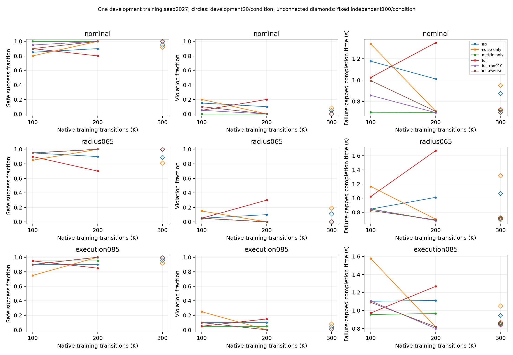
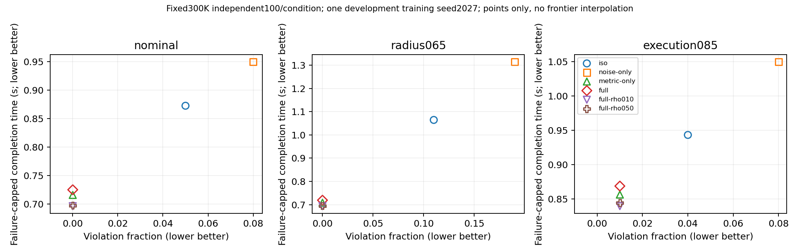
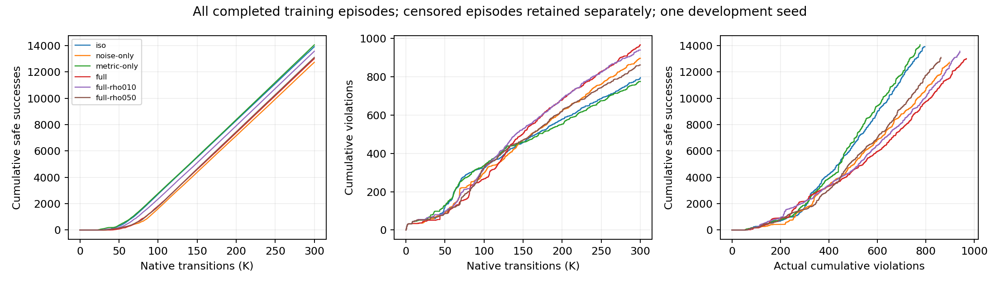

# 固定300K：六臂组件与参数包已全部完成

证据时间2026-11-15 01:29 UTC。原生源码b31878c0、已知开发训练seed2027、
相同fresh初始网络、每臂300K；没有终点重选、预算变更、额外训练或重测。
六条均完整300K，实际科学训练1.8M、终点独立回合1800；工程8步单列。
全18个评测节点、六份轨迹摘要及六份动作诊断齐备，CVPO另属30M包，未由本页替代。

## 独立终点：Full恢复，但没有优于Metric-only

每条件100个共同独立布局，6300027起；每格为安全成功／违规／安全超时的实际回合数。

| 版本 | 标准 | 半径65mm | 执行0.85 |
|---|---:|---:|---:|
| Iso |95／5／0|89／11／0|96／4／0|
| Noise-only |92／8／0|81／19／0|92／8／0|
| Metric-only |100／0／0|100／0／0|99／1／0|
| Full rho0.25 |100／0／0|100／0／0|99／1／0|
| Full rho0.1 |100／0／0|100／0／0|99／1／0|
| Full rho0.5 |100／0／0|100／0／0|99／1／0|

| 版本 | 标准失败封顶用时／秒 | 半径65mm | 执行0.85 |
|---|---:|---:|---:|
| Iso |0.8728|1.0644|0.9432|
| Noise-only |0.9500|1.3144|1.0496|
| Metric-only |0.7160|0.7084|0.8564|
| Full rho0.25 |0.7252|0.7192|0.8688|
| Full rho0.1 |0.6964|0.6936|0.8396|
| Full rho0.5 |0.6976|0.6948|0.8444|

在此seed、任务和预算下，能量度量是较明确的正向组件：Metric-only优于Iso，
而Noise-only三条件都较差。Full相对Iso改善终点任务—风险折中，
但相对Metric-only的安全成功／违规相同，用时略长，不支持“配套二者缺一不可”或额外采样收益。
Full在200K开发节点的回落未被隐藏；其300K恢复也不能证明训练稳定或不会再退化。
rho0.1／0.5终点计数均与默认相同，用时稍短；rho0.1比0.5快0.0012／0.0012／0.0048秒，
这些小差异不作为重新冻结方法或宣称统计显著性的依据。
三个rho在本开发训练seed的终点任务计数一致，但200K默认0.25明显回落，
参数与学习过程并不单调，不能由单seed终点相同推导无需调参或跨seed稳定。
0/100违规不代表零真实风险（Wilson95%上界约3.70%）；回合不作为训练seed重复。

## 训练期：终点更安全不等于探索代价更低

| 版本 | 全训练安全成功 | 违规 | 安全超时 | 完整墙钟／秒 | transitions/s |
|---|---:|---:|---:|---:|---:|
| Iso |13906|796|372|9820.86|30.55|
| Noise-only |12728|897|550|32374.13|9.27|
| Metric-only |14050|776|371|9993.23|30.02|
| Full rho0.25 |13003|967|516|32695.96|9.18|
| Full rho0.1 |13566|940|398|10067.49|29.80|
| Full rho0.5 |13098|862|443|9599.21|31.25|

Full相对Iso训练安全成功更少、违规更多；相对Noise-only成功更多但违规也更多。
不能用终点的正向结果代替训练期安全探索证据。
各臂更新数均298000 learner／596000 reward／148500 Actor；真实时间含全部评测与保存。
Full／Noise-only在共享A100，另外四臂在共享4080，不是受控纯算法加速比。

按既定每100次违规及共同上限776的最后真实回合节点比较，
上限776时累计安全成功为Iso13460、Noise-only10171、Metric-only14050、
Full9198、rho0.1 9602、rho0.5 11043；这些节点实际步数不同，不插值或混作同交互预算。
Full在上限200／300时优于Iso（909／2179对691／1750），
但上限100及400至776时更少，整体没有同违规预算的稳定优势。
rho0.5的全训练成功少于Iso、违规多于Iso；它也没有同时改善该探索任务／安全总计。
六臂完整曲线与所有预定违规节点现已[全部归档](exploration_results/actual_violation_budget.csv)。

## 匹配成功样本的训练覆盖：早期更广，后期未保持

三个预定100K窗口，各取四组件共同最小成功数N，按时间顺序前N条、5mm等弧长重采样、
20mm世界网格。表中为成功轨迹所占唯一世界网格数，所有原始成功数和失败分母仍保留。

| 窗口 | 匹配N | Iso | Noise-only | Metric-only | Full |
|---|---:|---:|---:|---:|---:|
| 0–100K |1614|994|1160|1086|1182|
| 100–200K |5535|771|727|693|749|
| 200–300K |5579|734|734|696|715|

Full相对Iso早期覆盖更大，但后两窗更小；早期匹配平均路径Full0.4817m、Iso0.4650m，
覆盖差仍需结合路径长度和任务数理解，不等于更多合法路线或拓扑多样性。
这补齐了新四臂训练期行为记录，不恢复旧训练缺失的轨迹，也不证明泛化因果。

## 固定状态的最终动作统计

六份诊断使用同一32状态×64共同Gaussian增量、原300K模型、单CPU，未新增仿真。

| 版本 | 平均within-state动作协方差trace | 限幅边界比例 |
|---|---:|---:|
| Iso |0.03401518|0.513671875|
| Noise-only |0.03564428|0.743164063|
| Metric-only |0.03773943|0.438476563|
| Full rho0.25 |0.03306937|0.651367188|
| Full rho0.1 |0.03140008|0.760253906|
| Full rho0.5 |0.03192009|0.589355469|

这不是风险法向投影；trace更大不代表更好探索，边界比例不是违规率。
完整[逐状态结果与共同池](action_structure/README.md)保留，不能将参考噪声vn/vt冒充最终动作VN/VT。

## 原始证据与剩余交付

每臂目录保留run_config、完整收据、三点评测、原生日志、原服务器完整轨迹摘要和收集标记：
[Iso](completed/iso/receipt.json)、[Noise-only](completed/noise-only/receipt.json)、
[Metric-only](completed/metric-only/receipt.json)、[Full](completed/full/receipt.json)、
[rho0.1](completed/full-rho010/receipt.json)、[rho0.5](completed/full-rho050/receipt.json)。
大模型与原始gzip仍留服务器数据盘。
本页所有轨迹统计复用既有`compare_summaries`规则，无额外RL或环境控制。
全部[54行学习节点表](component_results/all_checkpoints.csv)、
[18行独立终点表](component_results/fixed_300k_independent.csv)、
[训练／探索与轨迹图](exploration_results/INTERPRETATION_ZH.md)和
[六臂动作结构](action_structure_results/fixed_endpoint_action_structure.csv)均已生成。
以下图保留200K坏节点，独立300K不与开发段连线；效率图仅原始点，不插值前沿。

本1.8M组件／参数与同批探索交付已完成；尚余CVPO三seed与独立闭合，全目标未完成。
