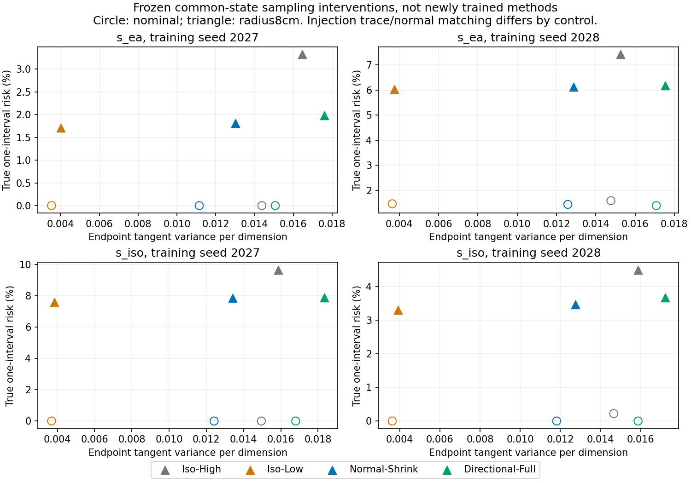

# Reach 冻结机制补充：M1/M2/M3 与采样器敏感性

实际完成源：`fe04b21b574da0b3bf326699feacb5b58de043ea`，A100共享GPU1；
原生Python PID4016671已正常退出。使用全部四个保留的固定1M Reach策略，未重训、
未只选好EA种子、未替换历史最终结果。本分析不是Payload或PointGoal结果。

## 范围与真实开销

新布局260027系列构造128个不同的共同状态：64近边界、64安全内部，包含四个来源
Actor与nominal/radius8cm两个条件。每状态64draws；不是把旧64状态复制成128。
3个source动作真实违规。109/128个真实有限差分轴有效，其中nominal49/64、radius8cm60/64；
19个平坦/未定义轴状态仍计入风险，只从投影方差中排除。

每种方法/条件的风险使用全部64状态×64draws=4096条动作。它是**所选共同状态上的
条件一步控制区间风险**，不是训练后on-policy episode风险，也不是4096个训练种子。
每个状态先完成动作生成，再调用真实模拟oracle；oracle未进入learned执行选择。

| 项目 | 实际开销 |
|---|---:|
| 新训练／optimizer／真实交互 |0／0／0|
| 新池45个episode |542控制区间|
| 128个共同source动作有限差分 |896控制区间|
| 所有冻结采样器动作真实label |425,984控制区间|
| 原生/共同采样器交叉720个episode |10,263控制区间|
| **总新增模拟控制区间** |**437,685**|
| 端到端完成耗时 |627.876秒|

全部M1/M2为32+32行，冻结参数敏感性40行，共104行。单动作计时16行。
Source动作区间margin复现MAE为3.05e-8m。完整账见
[receipt](arm-mechanism-fe04b21/receipt.json)，原始状态与逐状态结果在同目录。
M1-Directional-Full与M2-Pullback共享同一冻结干预法则，本次各自实际查询并计费，
没有将重复开销隐藏或伪称缓存复用。

## M1：方向分配不是单纯全局降噪声

有效q=1位置的注入协方差谱如下；输出终点协方差并未强制匹配。

| 干预 | 法向方差 | 每个切向方差 | trace |
|---|---:|---:|---:|
| Iso-High |.04|.04|.12|
| Iso-Low |.01|.01|.03|
| Normal-Shrink |.01|.04|.09|
| Directional-Full |.01|.055|.12|

High与Full匹配注入trace；Low/Shrink/Full匹配法向噪声，但切向和trace不同。
Sampling与energy使用相同D。所有Actor、alpha、margin和dual冻结；改变D后的energy
只作诊断，不能宣称Iso-Low已按新reference variance重新训练/调好temperature。

下表每格为 **radius8cm一步风险% / endpoint VT**，VT是每状态两个切向维度的平均，
再对有效轴状态取均值；不混合不同状态动作计算单个协方差。

| 冻结Actor | Iso-High | Iso-Low | Normal-Shrink | Directional-Full |
|---|---:|---:|---:|---:|
| Iso2027 |9.6436 / .01587|7.5928 / .00385|7.8369 / .01342|7.8613 / .01833|
| Iso2028 |4.4922 / .01587|3.2959 / .00391|3.4668 / .01276|3.6621 / .01721|
| EA2027 |3.3203 / .01645|1.7090 / .00401|1.8066 / .01301|1.9775 / .01760|
| EA2028 |7.4219 / .01526|6.0303 / .00376|6.1279 / .01288|6.1768 / .01752|

Full相对同trace的High在四个Actor上都降低这组条件风险，同时保留更多切向方差。
但Low风险更低，代价是切向方差显著减少；Full并未在“最低风险”指标上全面支配Low。
例如EA2027 Full/Low风险1.9775%/1.7090%，VT约4.39倍；EA2028为6.1768%/6.0303%，
VT约4.66倍。Normal-Shrink同样体现风险—切向探索折中，不可删去这条对照。

Nominal也保留：EA2028 High/Low/Shrink/Full风险1.5869/1.4648/1.4404/1.3916%；
Iso2028为.2197/0/0/0%；另外两Actor在该池nominal四干预均为0。零观测不等于理论零风险。

## M2：同谱的Local/Direct/Pullback/Random

固定q=1、rho=.25，共同预生成的噪声完全相同。Random的独立随机轴在每个采样动作
内部全程固定；它不使用oracle。下表为 **nominal / radius8cm风险%**。

| 冻结Actor | Local | Endpoint-Direct | Endpoint-Pullback | Random |
|---|---:|---:|---:|---:|
| Iso2027 |0 /8.4473|0 /8.1543|0 /7.8613|.0244 /9.5703|
| Iso2028 |.0488 /3.5889|.0244 /3.6621|0 /3.6621|.1465 /4.5166|
| EA2027 |0 /2.2705|0 /2.1973|0 /1.9775|0 /3.2471|
| EA2028 |1.4648 /6.3477|1.4404 /6.2988|1.3916 /6.1768|1.7090 /7.2998|

所有radius8cm条件的4096/4096draws均联合谱匹配；nominal除EA2027为4094/4096外
均完全匹配。EA2027这2个随机路径存在learned梯度无效fallback，未删去；联合匹配
子集风险仍为0。原始CSV同时提供全体和匹配子集的风险/VN/VT，不声称所有路径
天然同谱。

Pullback相对Local的radius8cm终点VN下降约18.2%、15.8%、25.3%、20.3%
（按表中Actor顺序）。但VT同时下降，而且Iso2028的风险略升，因此“几何更对”不是
“每个条件风险一定更低”。Random总体较差，支持方向分配有作用，而不只是总trace。

Source动作的直接learned法向与真实区间action-normal余弦约.964/.951/.941/.971，
但margin MAE仍约21.34/21.43/20.65/21.89mm。此余弦是**source直接法向**诊断，
不是每个随机注入点处的真实pullback-gradient误差，也不是value已校准的证据。

## M3：Actor与测试采样器的交叉

270027系列新共同布局；每格30个episode。三个采样器为native、共同Iso-High、共同
q=1 Pullback。此处只配对布局，不能把分歧后的轨迹说成逐动作的精确谱匹配。
所有720回合安全超时为0；违规数等于30减去成功数。

| Actor | Nominal成功：native /共同Iso /共同PB | Radius8cm成功：native /共同Iso /共同PB |
|---|---:|---:|
| Iso2027 |30 /26 /28|3 /2 /3|
| Iso2028 |30 /29 /30|20 /19 /19|
| EA2027 |30 /30 /30|25 /24 /26|
| EA2028 |25 /24 /25|2 /0 /1|

好EA2027即使去掉测试时方向调制，共同Iso也保持24/30成功，远高于Iso2027的2/30；
因此收益不能完全解释为测试时sampler。相反，坏EA2028在共同Iso/PB下仍差，
方向调制没有修复不好的Actor。这些是小规模机制证据，不替代最终固定终点主表。

EA2027 radius8cm的成功路线扇区三种采样器都为[4,5,6]；成功路线3cm world-voxel
并集111/107/108，没有明显增加覆盖。EA2028为28/0/13个voxel，成功数也不同，不能
把覆盖差单独解释为探索熵。所有覆盖只统计完整安全成功路线，是布局相关的小型代理。

## rho与K：冻结敏感性，不是额外重训

每格为radius8cm一步风险%，默认rho=.25/K4复用上面记录。

| Actor | rho=.1/.25/.5/1，K4 | K2/4/8，rho=.25 |
|---|---:|---:|
| Iso2027 |7.0557 /7.8613 /8.7891 /9.6436|7.8125 /7.8613 /7.8125|
| Iso2028 |3.3691 /3.6621 /3.8574 /4.4922|3.3691 /3.6621 /3.3691|
| EA2027 |1.7578 /1.9775 /2.2949 /3.3203|3.5400 /1.9775 /1.2939|
| EA2028 |6.1768 /6.1768 /6.6406 /7.4219|6.5186 /6.1768 /6.1768|

更强法向压缩可减少这组选态风险；K8只在部分Actor明显受益。不能把看过的这组
共同状态/8cm结果当成独立选择验证，更不能声称做过四rho×三K的公平完整训练。
rho=1与Iso-High在同共同噪声下的风险一致，是本次真实记录，不新增一项算法结果。

## 单动作效率

实际共享A100、eager PyTorch，单动作batch1，5次warmup+100次测量，CUDA同步。
每格p50 /p95，单位ms；不是完整训练SPS，也没有JAX编译。

| Actor | Local | Direct | Pullback | Random |
|---|---:|---:|---:|---:|
| Iso2027 |11.286 /12.962|13.785 /15.599|19.798 /22.809|18.660 /22.039|
| Iso2028 |10.273 /10.599|12.469 /12.972|19.684 /21.117|20.176 /22.707|
| EA2027 |10.583 /10.963|12.723 /13.445|19.224 /19.883|17.753 /18.476|
| EA2028 |11.121 /12.379|12.523 /14.889|18.552 /18.940|18.632 /18.968|

K2/4/8的8192动作batch通常约.008–.009/.020–.024/.065–.067秒，但首个Iso2027
K4测量为.483秒（未预热/共享运行）；不隐藏该值，也不据单次batch给出可靠速度排名。
PointGoal完整训练吞吐、optimizer比与编译显存由CRAX主线另报告。

结论：本次支持“合理方向分配可在保留切向变化时减少条件风险”和“Pullback有
同谱局部收益”，同时保留更小全局噪声的风险优势、坏Actor、未改善覆盖和计算开销。
这些证据不要求所有seed都赢，也不允许删去负例后宣称普遍安全。
