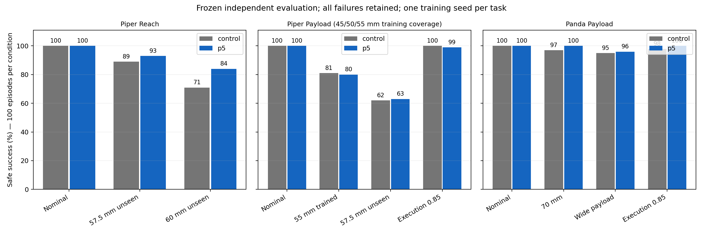

# v11 最终结果：原生任务 P5 与 Piper Payload 几何覆盖

2026-11-18。六条首批配对训练全部完成新增 100K；基于 Payload 55mm 终止动作 margin 低估约 10mm 的诊断，再追加一组共享 45/50/55mm 覆盖配对（control/P5 各新增100K）。总新训练量 **800K/900K 上限**，未使用最后100K。SafeReach 保持冻结；未重跑 PointGoal；无实机交互。

一次性最终冻结选择：Piper Reach 使用首批 P5；Piper Payload 使用覆盖候选 P5，保留该覆盖分布下的 control 配对；Panda Payload 使用首批 P5。未按独立结果重新选择。另运行固定历史 Piper Iso60K 作为速度参考，非同轮等预算对照。

## 配对训练端点

|任务|control 违规／成功／超时|P5 违规／成功／超时|P5 违规变化|P5 成功变化|
|---|---:|---:|---:|---:|
|Piper Reach 首批|174／3336／0|55／3259／0|−68.4%|−2.3%|
|Piper Payload 首批|178／3038／0|63／2855／0|−64.6%|−6.0%|
|Piper Payload 覆盖候选|204／2870／0|136／2738／0|−33.3%|−4.6%|
|Panda Payload 首批|423／5211／0|184／5143／0|−56.5%|−1.3%|

训练累计违规大幅下降，但累计安全成功也略少；所有配对无安全超时。训练违规与固定DEV/独立风险是不同统计量，不据其单独声称完成安全目标。

## 冻结模型独立评测

每个最终模型每条件100回合，逐条件列出安全成功/违规/安全超时：

|任务／最终P5|条件|control|P5|
|---|---|---:|---:|
|Reach 首批|nominal|100／0／0|100／0／0|
|Reach 首批|57.5mm 未见|89／11／0|93／7／0|
|Reach 首批|60mm 未见|71／29／0|84／16／0|
|Piper Payload 覆盖|nominal|100／0／0|100／0／0|
|Piper Payload 覆盖|55mm 覆盖内|81／19／0|80／20／0|
|Piper Payload 覆盖|57.5mm 未见|62／38／0|63／37／0|
|Piper Payload 覆盖|execution 0.85|100／0／0|99／1／0|
|Panda Payload 首批|nominal|100／0／0|100／0／0|
|Panda Payload 首批|70mm|97／3／0|100／0／0|
|Panda Payload 首批|wide payload|95／5／0|96／4／0|
|Panda Payload 首批|execution 0.85|98／2／0|100／0／0|

关键结论：

- **Reach P5 改善未见几何**：57.5mm 为93% vs 89%，60mm 为84% vs 71%；仍分别有7%和16%违规，未达到逐条件风险≤10%的严格方向。
- **Panda P5 保留了高成功率**：四条件96–100%；相对配对 control 违规数减少，但这是单个训练seed下的描述结果，不是跨seed稳定性证明。
- **Payload 仍未达标，且 P5 不优于同轮覆盖 control**：首批P5的55mm DEV为50%，覆盖候选P5为76.7% DEV、独立80%；但两批DEV布局不同，不能据此证明覆盖的因果收益。独立覆盖control为81%，57.5mm独立P5仅63%/37%违规，control为62%/38%。覆盖诊断支持一个改善方向，但不能声称P5在该任务/几何上进一步降风险，也未达到55mm≥90%的目标。
- **Payload execution 0.85**：覆盖P5为99安全成功、1违规，control为100/0。不要用几何收益掩盖这一个失败。

### 历史 Iso 速度参考

历史 Iso60K 同轮target Actor重新评测（并非同训练预算对照）：nominal为84成功/16安全超时/0违规；55mm为74成功/25超时/1违规；execution085为80成功/20超时/0违规。P5 覆盖候选相应为100/0/0、80/0/20、99/0/1。

成对布局的平均 horizon-capped 时间：P5 vs Iso 为 nominal 1.390s vs 2.741s、55mm 1.914s vs 2.904s、execution085 1.648s vs 3.030s。后两个速度差异部分来自Iso较多安全超时，不能解释为等风险速度优势；55mm P5有20次违规而Iso仅1次，故明显是安全—速度折中。Iso与最终模型共享布局seed；nominal/55mm共享动作seed，但 execution085 因新增57.5mm条件导致条件索引不同，动作噪声seed不相同。历史Iso年龄/预算也不同，所有速度比较仅描述性。

## 证据与限制

独立集冻结的六个最终模型共2200回合；历史Iso另300回合；总计2500回合、300个布局seed，全部接纳，未用训练或DEV以外的筛选。Wilson区间和配对布局仅反映当前固定策略/布局的描述不确定性，不包括训练seed不确定性，不构成风险等价检验。

两次 Reach 独立评测工程启动均在首回合前因资产身份字段读取兼容错误退出；原registration/消费标记保留。期间排查曾意外使用第一个预留独立布局执行一次 online Actor 单步（无完整回合结果、未反馈训练或选模），这属于协议偏离，应保留而不能称作完全零额外独立交互；随后所有最终模型在已冻结选择下完成一次完整评测。Panda使用v2、Reach/Payload使用v3，case身份与任务规则相同，冻结SHA分别记录。无外部GPU任务被停止。

**最终判断：**P5 对 Reach 几何外推及三个任务的训练违规有实际收益；Panda独立任务能力保留良好。Piper Payload覆盖候选的独立集仍有20–37%违规，且P5未胜过同轮覆盖control；跨批DEV差异不能单独证明覆盖收益。Piper Payload安全目标没有解决，具体瓶颈是几何变化下的风险值泛化与边界响应；保留负结果，不再花最后100K进行无机制搜索。

## 复现/分析文件

- [DEV 冻结选择审查](FINAL_DEV_FREEZE_REVIEW_ZH.md)
- [首批600K结果与诊断](FIRST_STAGE_REVIEW_ZH.md)
- [覆盖候选审查](OPTIONAL_PAYLOAD_COVER_REVIEW_ZH.md)
- `independent_final_results/analysis_complete/condition_summary.csv`：全部固定条件的终端计数、用时、路径及距离
- `independent_final_results/analysis_complete/paired_outcomes.csv`：共享布局配对结果与速度描述
- `independent_final_results/analysis_complete/all_episodes.csv`：2500条逐回合记录，不含轨迹点列
- 原始完整独立回合轨迹只留服务器/本地归档，不上传GitHub
