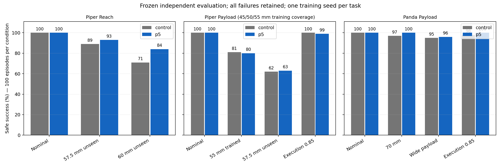

# v11 原生任务配对适应：最终结果入口

**本轮已结束：800K 新训练，2500 个完整独立回合。** 详见 [最终报告](FINAL_RESULTS_ZH.md)，[独立结果表](independent_final_results/analysis_complete/condition_summary.csv) 和 [完整配对记录](independent_final_results/analysis_complete/paired_outcomes.csv)。

P5 独立安全成功：Reach nominal/57.5/60mm 为100%/93%/84%；Panda nominal/70mm/wide/execution085 为100%/100%/96%/100%；Piper Payload覆盖候选 nominal/55mm/57.5mm/execution085 为100%/80%/63%/99%。Piper Payload几何安全目标未解决，保留负结果。

首批600K和覆盖配对200K均完整收据确认，最后100K额度未使用。独立评测后不再训练或选模。全部原始轨迹和完整检查点在本地/服务器归档；GitHub仅含精简表、曲线、配置、源码和审查。下方是按时间保留的历史记录，其“运行中/尚未测试”描述只对应当时节点。

最新阶段：2026-11-17 14:29 UTC，[四条训练的首个固定20K节点](FIRST20K_REVIEW_ZH.md)已保留。
Reach P5的57.5/60mm成功为80%/70%，但违规仍20%/30%；Panda加宽载荷P5仅90%，不掩盖负结果。
相同新增20K训练违规减少60.0%/37.3%，两项累计成功稍低、均无超时。继续到完整100K，不选20K替代终点。

更新：2026-11-17 14:16 UTC。**这不是最终结果，也没有打开独立测试。**
已启动Piper Reach与Panda Payload的四条原生训练；Piper Payload两条已登记，等待A100有限槽位释放。
首批总预算600K新增真实训练步，整轮含有依据的小候选上限900K。SafeReach P5保持冻结。

| 当前片段（同新增步数） | control违规／成功／超时 | P5违规／成功／超时 |
|---|---:|---:|
| Piper Reach，8K | 17／261／0 | 5／256／0 |
| Panda Payload，6K | 37／307／0 | 34／301／0 |

以上仅早期训练累计数，不是DEV安全成功率，不据此宣称达标或选模型。
当前约37 steps/s（A100每臂）、22 steps/s（4080每臂）；假设负载不变，
600K首批大约还需1.5—2小时，包含节点评测与存档的粗略余量。共享负载可变，非承诺完成时刻。
每20K的固定DEV、100K完整终点、后续候选判断与一次冻结独立评测尚未完成。

- [预登记及目标](PREREGISTRATION_ZH.md)
- [完整配置与新seed区间](../../configs/paper_crax_payload/performance_gaps_v11.json)
- [三份原生父模型针对性检查](TARGETED_CHECKS.json)
- [零训练步启动故障及显式RNG映射修复](ENGINEERING_AMENDMENT.md)
- [新布局小诊断解读](DIAGNOSTIC_REVIEW_ZH.md)
- [诊断原始逐状态CSV](diagnostic/samples.csv)
- [诊断汇总与额外仿真账目](diagnostic/summary.json)
- [A100/4080启动快照、完整片段曲线和原生运行配置](launch_snapshot/)

两臂保留各任务同一原生父状态的网络、优化器和回放；不是Panda权重改名成Piper。
共同LR按新增60K—80K退火，两臂统一既有target Actor部署；不改安全阈值/horizon/成功定义。
训练源码：Panda `f618f23d573b91ced461775ac7fa4125e12ffec4`；
Piper `d97474dac98f91c1fac9cd6b20b0698b7e4fdccb`；
独立诊断源码 `1af96e429ec09cfdb3f737a85a30ff6032c8fc74`。
Piper修订只修正原cuda:1生成器到单GPU槽的显式映射，未改方法、任务、seed或预算。

A100与4080均有只读30分钟观察进程，记录真实PID、进度、GPU和磁盘；有限队列结束后自行退出，
不自动重试、不影响其他项目。新增大型文件留在两台机器数据盘，不使用5080/实机。
本入口及小结果可上传GitHub；不创建PR、评论或主动邮件。
