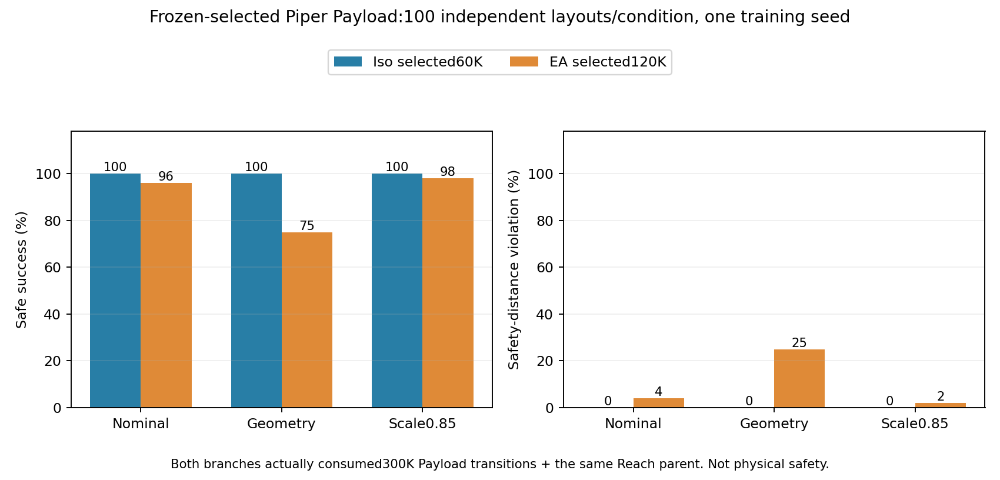

# SAFEFLOW2027 关键结果汇总

更新：2026-11-14（北京时间）。本轮已启动的 A100 训练、评测和机制分析已完成。
4080 已经通过 IPv6 恢复连接，原有 Panda Payload 检查点文件仍在4T盘；本次只整理和上传，不新增训练。

## 一句话结论

PointGoal 的冻结 EA 候选有任务/安全折中优势；Piper Payload 当前更稳健的候选是
Iso，而不是 EA。Reach 的几何适应改善了两种方法，但违规率仍高；不能据此直接上实机。

## 1. Piper Payload：独立测试

每个条件100个新布局，单训练seed；按共同验证选定并冻结后才测试。
下表为“安全成功率 / 安全距离违规率”。

| 选定模型 | 标准任务 | 几何变化 | 执行尺度0.85 |
|---|---|---|---|
| Iso60K |100% / 0%|100% / 0%|100% / 0%|
| EA120K |96% / 4%|75% / 25%|98% / 2%|

标准条件成功回合平均用时：Iso2.324秒，EA1.384秒。EA 更快，但违规更多。
两条分支实际均训练到300K，并共享300K Reach父策略；快照年龄不是总训练成本。
Iso 的零观察违规不等于真实风险为零，更不是真机保证。

不能隐藏固定300K终点的回落：30回合开发评测中，Iso三条件安全成功率为
100% / 10% / 66.67%，EA为83.33% / 23.33% / 63.33%。完整曲线与选定策略结果分别保留。
验证布局有30个与开发布局重合；独立测试布局另取71027–71126。仅一个训练seed。

[独立结果和模型说明](payload_closure/README.md) · [独立结果CSV](payload_closure/independent_summary.csv)
· [600回合记录](payload_closure/independent_episodes.csv) · [完整学习曲线](piper_results/piper_new_learning_curve.csv)

## 2. Piper Reach：等额几何适应后的独立测试

两种方法均在原有300K基础上适应100K；每条件100个独立布局。

| 模型 | 标准安全成功 |55mm几何安全成功 | 执行尺度安全成功 | 几何违规 |
|---|---:|---:|---:|---:|
| Iso400K |100%|72%|99%|28%|
| EA400K |100%|70%|100%|30%|

两者均改善，但没有 EA 一致优于 Iso 的证据。55mm在适应训练范围中，不是未见半径外推；
28%/30%几何违规仍超过10%规则，不能启用实体运动。原始 Iso-Low 参考始终无任务成功。

[结果与冻结模型](reach_adapted_release/README.md) · [验证/独立结果CSV](reach_adapted_release/results.csv)

## 3. PointGoal：区分选定策略与跨训练seed结果

下表是每种方法一个验证选定策略的500回合独立测试，不是跨训练seed平均；成本预算25。

| 方法 | 目标数/回合 ↑ | 平均成本 ↓ | 选中训练快照 |
|---|---:|---:|---|
| SAC-Lag |1.93|13.20|seed51029，2,016,256步|
| Stable-Iso |28.29|26.85|seed51028，10,000,128步|
| EA |35.43|21.32|seed51029，8M步|

EA 平均成本低于25，但预算合规回合比例为73.2%，不是每回合都合规。
三训练seed固定10M终点的目标数/成本均值±样本SD如下，不能用选定的好策略替代：

| 方法 | 目标数 | 成本 |
|---|---:|---:|
| SAC-Lag |36.24±0.12|41.28±2.11|
| Stable-Iso |11.87±13.79|22.26±2.51|
| EA |27.47±8.58|21.97±5.07|

[选定策略独立CSV](paper/pointgoal_selected_independent.csv)
· [三seed终点CSV](paper/pointgoal_fixed_10m_summary.csv) · [论文材料](paper/README.md)

## 4. 机制、效率与预算

- 最终机制分析完整执行16,704次原生查询，CPU用时50.73秒，零新增训练。
  方向方差小幅变化，但原生成本没有一致改善；各采样器在每个状态上的事件率相同。
  这是未能分辨事件安全收益的结果，不更换状态池寻找正例。
- 三个短profile完整SPS为10.63 / 32.46 / 57.66；实际EA200K续训38.07SPS，含评测/保存。
  更新数量变化且共享负载未控制，不能当作学习等价或纯硬件加速。
- 本轮新增训练共830K，未使用的1.37M上限不是必须花完的预算；不启动额外矩阵。
- A100实验大文件已迁入数据盘，旧路径保留软链接；约68.54GiB逻辑文件完成迁移。

[机制结果](paper/final_mechanism/README.md) · [完整训练效率CSV](piper_results/piper_new_efficiency.csv)

## 5. 4080恢复与仍未完成的工作

2026-11-14 09:26（北京时间），通过保存的IPv6连接复核：主机447、用户carla、
RTX4080 SUPER；4T数据盘剩约865GB。六个Panda Payload300K完整检查点文件存在，
但本次未加载验证其可恢复性，也未启动修复训练。此前“4080无法连接”已不再是当前状态。

完整父状态确认及有限修复仍待继续；实际部署电脑推理延迟、TCP/坐标/周期/速度/工作空间
现场校准仍未完成。所有导出模型均关闭实体运动权限，当前仅离线仿真。

[详细决策报告](FINAL_DECISION_REPORT.md) · [任务状态](STATUS.md)

## 文件与GitHub位置

GitHub仓库：`lzqw/SAFEFLOW2027`；本轮分支：`codex/paper-robot-gap-v2`，PR15。
程序、报告、CSV、PNG/PDF和小型冻结模型包均在该分支；不表示已经合并到主分支。
大型完整恢复检查点、原始轨迹/缓存保留服务器数据盘，SSH私钥和密码不上传GitHub。
