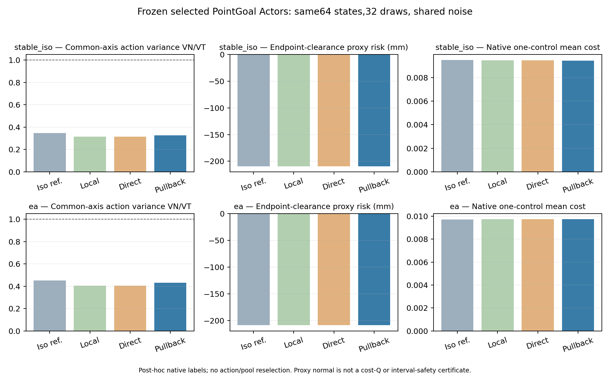

# Final selected-model PointGoal mechanism

Execution device: `cpu`; native backend: `cpu`. CPU/GPU execution and Gaussian generators are not claimed bitwise equivalent. The device was fixed before any sampled native label; all sampler arms share the same noise.

Actual64×32 study, two frozen Actors and all four sampler interventions. These are common-state training-distribution diagnostics, not independent episode tests. VN/VT is the ratio of the mean within-state variances on valid common axes; it is not an average of per-state ratios. All states remain in the admitted pool.

The normal comes from native one-control endpoint-clearance proxy finite differences at zero action, after sampled actions were frozen. It is not a learned cost-Q normal or a minimum-distance-over-the-control-interval certificate.

The raw `native_cost_events_discriminative` flag denotes a mixed-cost pool, not a detected difference between samplers. The table below measures the latter directly.

| Actor | States whose event rates differ across samplers | All-zero states | All-positive states |
|---|---:|---:|---:|
|stable_iso|0/64|60|4|
|ea|0/64|60|4|

Identical event rates do not prove equal native cost magnitudes. If event rates do not change, this fixed pool cannot establish an event-safety benefit. No pool replacement, extra sampling or retraining is authorized by this report. The original plan, pool, per-state labels and receipt are retained under `native/`.

