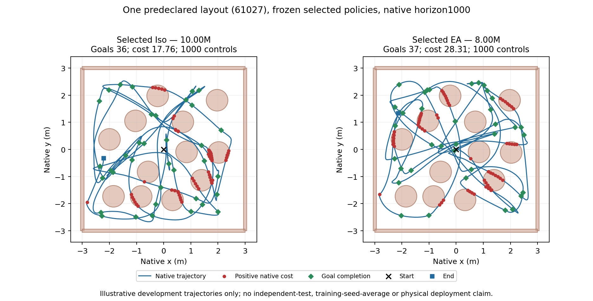

# Prospective selected-policy trajectory examples

These are the first and only rollouts requested on the prospectively fixed
development layout61027: one native1000-control episode for each exact selected
policy, with identical initial physical states and separate frozen input
normalizers. They are illustrative trajectories, not independent tests or
training-seed averages. No layout or policy was replaced after seeing results.

| Frozen policy | Goals/native return | Native cost |
|---|---:|---:|
| Iso51028/10,000,128 |36|17.7555|
| EA51029/8,000,000 |37|28.3121|

EA exceeds the25 cost budget on this particular episode, while Iso does not.
This example does not reproduce the selected-policy aggregate safety advantage;
it is retained rather than replaced with a more favorable layout. The existing
500-episode-per-method independent results remain a separate, unchanged claim.
Positive-cost markers are native cost, not inferred margin/proxy labels.
Green markers denote goal completion, with native goal refresh unchanged.

`trajectory_controls.csv` includes all2000 actual controls, positions, actions,
native rewards/costs/goals and refreshed goal positions. `native_geometry.json`
retains the initial native hazard/goal layout. `receipt.json` binds selected
model hashes and the shared physical-state hash. Raw source JSON hashes are
in `raw_source_sha256.json`; full raw inputs stay in the local source mirror
and on the A100 data disk.

Capture used the native MJX simulator on CPU and finished in72.54s, withzero
RL/optimizer updates andzero physical robot interactions. This is not the
separately queued final64×32 mechanism study or a physical deployment result.

Capture: `scripts.paper_crax_payload.pointgoal_examples` (sourceedfbd6dc).
Compact rendering: `scripts.paper_crax_payload.pointgoal_plot_examples`.
