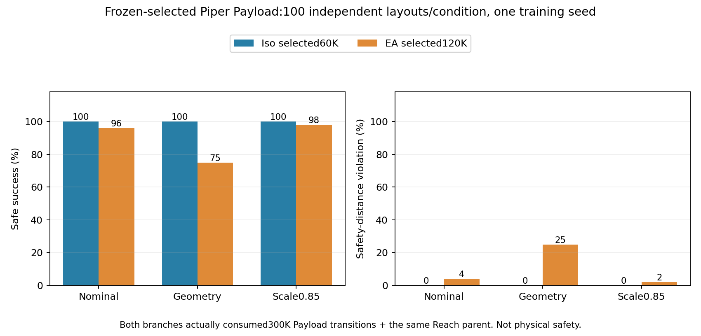

# Frozen-selected Piper Payload: completed independent closure

Both common-parent transfer branches actually consumed300K Payload transitions
each, following the same300K Reach/Iso Actor parent. The selected snapshot is
not the actual experiment's training expenditure. Both fixed300K endpoints and
all regressions remain separately preserved in [piper_results](../piper_results/README.md).

## Independent layouts, not development scores

| Frozen validation-selected policy | Nominal success / violation | Geometry success / violation | Scale0.85 success / violation |
|---|---|---|---|
| Iso60K |100% /0%|100% /0%|100% /0%|
| EA120K |96% /4%|75% /25%|98% /2%|

Each cell uses100 layouts71027–71126, one training seed41027. All600 compact
episode records are in `independent_episodes.csv`; full raw trajectories remain
on the A100 data disk and in the local source mirror. Iso is a useful simulated
transport candidate, not a globally zero-risk or physical-safety certificate.
EA is faster on successful nominal episodes (mean1.384s versus Iso2.324s), but
has more violations; no universal task/safety dominance is claimed.



Each method received exactlyfive canonical60/120/180/240/300K opportunities,
50 common validation layouts/condition (1500 episodes total). Common validation
selected Iso60K at100%/98%/100% safe success, risk-qualified; EA120K at
100%/72%/98%, an explicit non-risk-qualified Pareto candidate. Both identities
were frozen before any independent labels. Selection SHA256:
`2ded883a239df2958a438d1d5be5aca5d1ae896cb06cf8416a4c7ccc9f7ae576`.

Protocol registration followed initial100K development curves for the bounded
continuation decision; it was not blind to those development outcomes.
Validation layouts61027–61076 overlap the30 development layouts61027–61056;
validation is not an unseen-layout claim. The disjoint independent stream
is the confirmation. No model/test-layout reselection or extra training occurred.
Selection used only validation, not the independent100% scores reported here.

## Actual frozen inference packages

`bundles/{iso,ea}` contains actual selected Actor/EMA-margin weights, frozen
normalizer, action scale/model identity, integrity manifest and the selected
checkpoint's training receipt. `selection-{iso,ea}.json` derives directly from
the pre-test selection, not a new test-based choice. These are small inference
packages, not full replay/RNG recovery states. All motion/transport/physical-
eligibility flags remain false; the current first on-site plan is still Reach,
not Payload. No extra rollout, inference benchmark or physical command was run
to export these packages. Server CPU latency of a Reach policy is not latency
of this Payload policy or of the deployment computer.

The10 validation candidates and two independent policies performed74,988 native
control intervals,1,499,760 physics substeps and1,578,950 distance queries.
All600 individual test flags/seeds and aggregate control accounting were checked
against these genuine records. Zero new RL or physical interaction.

Reproduce compact tables/figure from retained records, without model loading:

```bash
python -m scripts.paper_crax_payload.piper_payload_pack \
  --input /path/to/retained/payload-closure \
  --output reports/robot_gap_v2/payload_closure
```

Native source `piper_payload_closure.py` is the registered evaluation controller;
`piper_train export` is the existing frozen export command. No independent test
should be rerun merely to regenerate a figure or restore a monitor status file.
