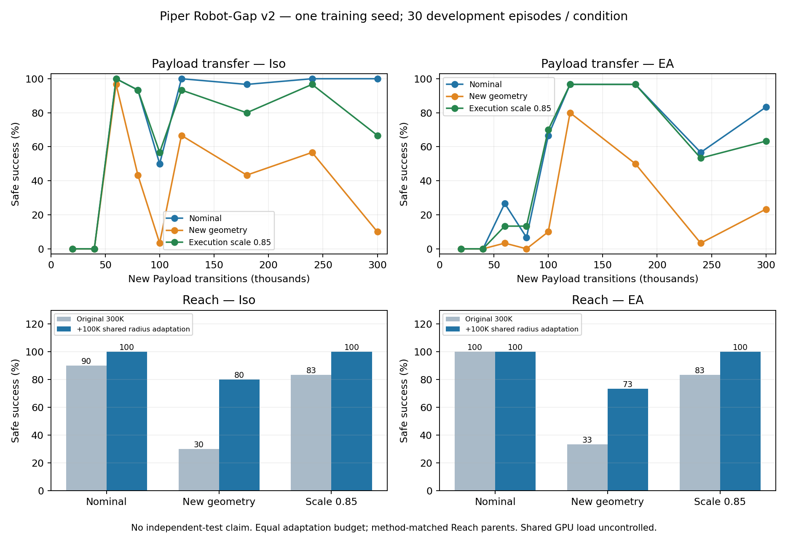

# Completed Piper transfer and geometry adaptation

`piper_new_learning_curve.csv` retains all60 condition/checkpoint rows from
six completed branches, including both300K Payload continuations;
`piper_new_efficiency.csv` records exact
new transitions, elapsed time, stage timing, update counts and new violations.
`receipts/` contains the corresponding genuine completion receipts. Raw
episode trajectories remain on the A100 data disk and in the local source
mirror, not Git. No simulation or training was added to produce these files.



One training seed41027,30 fixed development episodes/condition. No independent
test, training-seed uncertainty or physical safety claim. The original Reach
300K comparison is from the same development protocol, not the separately
selected50-episode common-validation candidates.

Transfer learns but regresses: Iso60K safe success was100% nominal,96.67% new
geometry and100% scale0.85; at100K it is50%/3.33%/56.67%. EA100K is
66.67%/10%/70%. Retain all checkpoints and do not relabel an intermediate maximum
as a fixed-budget result. EA's100K training violations366 exceed Iso226.

Equal100K Reach radius adaptation improves new-geometry success from30→80%
(Iso) and33.33→73.33% (EA). Both nominal/scale reach100%; geometry violations
remain20%/26.67%, above the prior release's10% risk qualification threshold.
There is no universal EA advantage or physical deployability demonstrated.
The condition retains its original name `new_geometry`, but55mm is included
in the adaptation training-radius family. This is geometry-distribution repair,
not extrapolation to an unseen radius. Independent-layout tests are separate.

The continuation uses each fixed100K Payload endpoint, with200K more per
method and identical full-state resume. No curriculum, geometry change or
additional candidate search. Iso is complete: its300K endpoint has100% nominal,
10% geometry and66.67% scale safe success, with0%/90%/33.33% violations.
Its geometry success was66.67% at120K,43.33% at180K and56.67% at240K;
the poor300K endpoint is preserved rather than silently replaced. Nominal
learning has stabilized more than robustness. The200K continuation took
3019.12s (66.24SPS) with456 new training violations; cumulative Payload
training violations are682 including the first100K. These are development
results, not the pending common-validation/independent closure.

EA's continuation is also complete. Its300K nominal/geometry/scale safe success
is83.33%/23.33%/63.33%, with16.67%/76.67%/36.67% violations. At120K it reached
96.67%/80%/96.67%, declined at180K, collapsed to56.67%/3.33%/53.33% at240K,
then partially recovered. All checkpoints are retained;300K does not replace
or erase the regressions. The200K segment took5253.53s (38.07SPS) with481 new
training violations (847 cumulative Payload violations). Equal additional
budgets do not establish a universal EA advantage: Iso has higher nominal
success, EA has higher but still poor geometry success, and scale is similar.

| Fixed300K Payload endpoint | Nominal | Geometry | Scale0.85 | Cumulative training violations |
|---|---:|---:|---:|---:|
| Iso |100%|10%|66.67%|682|
| EA |83.33%|23.33%|63.33%|847|

These remain30-episode development results from one training seed. The queued
closure uses exactly the canonical five checkpoints/method and new independent
layouts after freezing both selections. It has not completed yet. Neither
fixed300K endpoint solves robustness; no further training is automatically
authorized. The figure uses identical x-axis scales for both methods.

Regenerate from retained input records:

```bash
python -m scripts.paper_crax_payload.robot_gap_results \
  --runs /path/to/campaign_runs \
  --old-finals reports/robot_gap_v2/piper_existing_finals.csv \
  --output reports/robot_gap_v2/piper_results
```

Complete segment SPS includes simulation, replay/learner, evaluation and save.
Engineering profile SPS elsewhere excludes its separate post-profile eval;
shared GPU load and different optimizer-update counts preclude an exact
optimization-equivalence or hardware-only speed claim.
