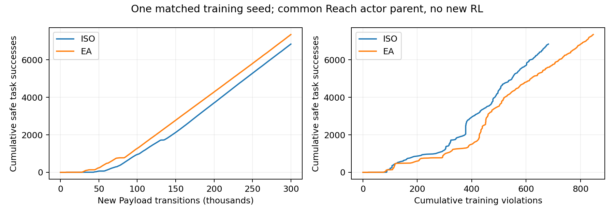

# E05：复用日志的任务／成本桥梁，零新增训练

来自已完成的共同Reach父Actor→Payload两分支，训练seed41027，两方法各300K新步数。
这不是跨训练seed显著性检验，也不是本次Panda有限修复的成绩。

## 1. 相同交互预算：EA更早发现任务、累计完成更多，但也违规更多

| 新Payload步数 | Iso累计安全成功／违规 | EA累计安全成功／违规 |
|---|---:|---:|
|50K|66 / 88|238 / 113|
|100K|953 / 226|1275 / 366|
|200K|3703 / 474|4284 / 547|
|300K|6840 / 682|7349 / 847|

300K时EA累计安全成功多7.44%，同时累计违规多24.19%。不是安全成本同时占优。
训练成功计数反映整个策略演变，不可与选中快照的独立部署成功率互相替代。

## 2. 相同违规预算：没有观察到EA更高效的任务发现

取1000步日志网格上“累计违规不超过预算”的最后一个节点，不插值，不虚构恰好相等风险。

| 违规上限 | Iso安全成功（实际违规／步数） | EA安全成功（实际违规／步数） |
|---|---:|---:|
|100|212（100 /66K）|134（89 /43K）|
|200|844（188 /95K）|589（196 /66K）|
|400|2943（400 /176K）|1485（397 /107K）|
|600|5685（598 /263K）|4802（597 /217K）|

因此本日志不能支持“在相同累计违规下EA发现更多任务”。按相同交互数和按安全开销
比较得出的排序不同，应如实报告。共同Reach初始化和训练设置相同，但不能仅凭两条
完整策略轨迹把差异唯一归因于局部探索协方差或某个几何组件。



## 3. 冻结策略轨迹占用：仅描述，不是训练期覆盖或替代路线证明

复用上一轮已完成独立测试，不再次rollout。每条件只取两方法都成功的相同layoutseed，
数量为标准96、55mm几何75、scale0.85执行98；不让较多成功样本自然占用更多空间。
按世界坐标20mm网格，先将记录折线每5mm弧长重采样，避免较慢控制采样点多造成偏差。
标准条件Iso/EA占用130/96格；几何111/83格；执行121/97格。

没有发现EA在此描述中更广的成功轨迹占用。占用更大也不自动意味着任务更好——
更长绕路同样会占用更多格。旧轨迹缺少初始点，因此路径只包含已记录点之间的段；
新E02代码已修正为包括初始到第一步，但不能反向补造历史记录。

训练日志没有完整的每episode训练轨迹，无法计算训练期成功路径覆盖，也无法识别
同伦／合法替代路线数量。这一缺口明确保留，不用冻结策略占用替代“发现更多路线”。
E04仍需单独具备初始安全和方法无关可行路线证明；本页没有完成它。

## 可复现文件

- `learning_counters.csv`：两条完整1000步网格，含原始累计终类计数。
- `fixed_transitions.csv`：共同交互预算切片。
- `within_violation_budget.csv`：共同违规预算的日志节点，无插值。
- `paired_success_occupancy.csv`、`occupied_cells.csv`：配对成功样本占用与样本数。
- `receipt.json`：源日志和原独立JSON的SHA256；零新增RL、仿真或实体操作。

源日志已从A100保存本地`robot_gap_v3_sources/training_logs`，原始独立轨迹继续在
`robot_gap_v2_sources/payload_closure`。生成脚本：

四份源计数日志也随本目录`source_logs/`上传，SHA保持与receipt中对应原文件一致。

```bash
python -m scripts.paper_crax_payload.piper_exploration_bridge \
  --logs /home/lzqw/SAFEFLOW2027_delivery/robot_gap_v3_sources/training_logs \
  --closure /home/lzqw/SAFEFLOW2027_delivery/robot_gap_v2_sources/payload_closure \
  --output /a/new/output/directory
```
