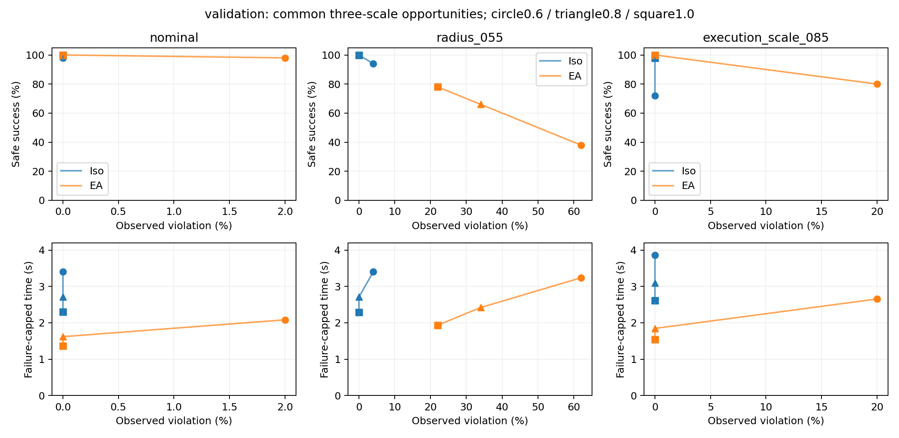
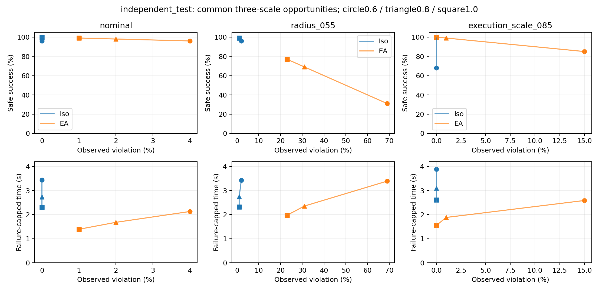

# Frozen E02/E03 results

Status: `completed`; 42 completed condition rows, 3300 attempted episodes.

[中文结果与局限](INTERPRETATION_ZH.md): at the validation-selected scale, both policies
achieve 100/100 safe successes and 0/100 observed violations under execution scale 0.85;
EA failure-capped time is 40.5% shorter. Geometry safety remains weak. This is not a
global matched-risk, cross-training-seed or physical-robot claim.

This report only reads retained evaluation files. No new rollout, RL or policy reselection.
A validation risk-cap label is not proof of equal actual independent-test risk.
Failure-capped time gives every failed episode the entire native4s horizon.
One training seed; the policy candidate checkpoint age is not total training expenditure.

Exact per-condition rates/counts/clearance/path/time: `condition_summary.csv`.
All compact episode rows: `episodes.csv`. Missing/admissibility denominators are retained.

