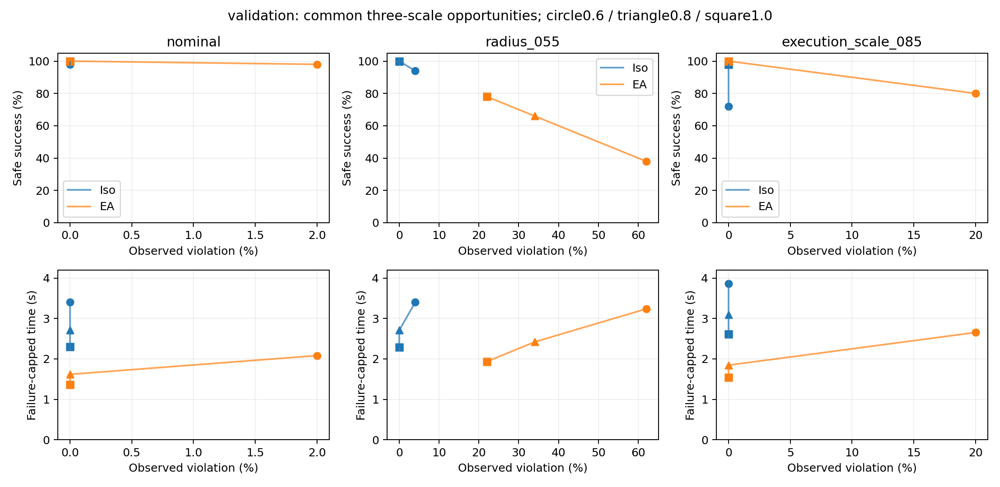

# Frozen E02/E03 partial evaluation

Status: `partial_completed_groups_only`; 18 completed condition rows, 900 attempted episodes.

This report only reads retained evaluation files. No new rollout, RL or policy reselection.
A validation risk-cap label is not proof of equal actual independent-test risk.
Failure-capped time gives every failed episode the entire native4s horizon.
One training seed; the policy candidate checkpoint age is not total training expenditure.

Exact per-condition rates/counts/clearance/path/time: `condition_summary.csv`.
All compact episode rows: `episodes.csv`. Missing/admissibility denominators are retained.

Independent evaluation and/or unseen-condition work is still running; do not call this final.

