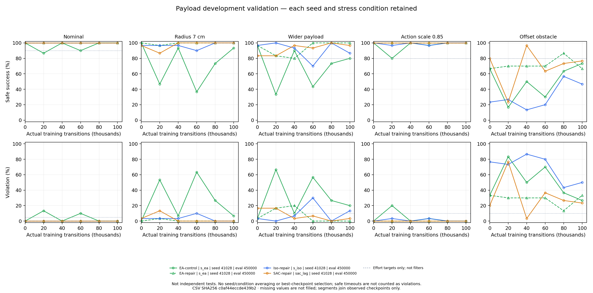

# 四分支完整100K开发曲线

四条原生预算均完成，全部20/40/60/80/100K节点及实际历史父参考一并保留，
未重跑仿真，没有用终点替代好候选或只挑正面节点。横轴为新增训练步数，
父快照年龄EA240K、Iso120K、SAC300K不同，不是相同历史总训练成本。

见[全部开发CSV](development_curve.csv)、[实际来源哈希](receipt.json)和
[共同验证后的审议](../E01_STAGE1_REVIEW_ZH.md)。图中历史偏移条件不证明合法替代路线，
未纳入共同验证。开发结果与4000回合验证／后续独立测试是不同数据，不混称独立结论。

