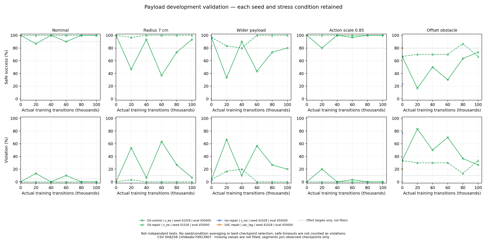

# Panda EA：两条100K完成后的完整开发曲线

两条均从同一个seed41028原生240K父状态新增100K；完整优化器、replay、dual等保留。
两条完成收据见[对照](../completed_ea_receipts/control.json)、
[半径修复](../completed_ea_receipts/repair.json)。耗时68.4/69.2分钟，均含评测与保存。
Iso/SAC尚待原定100K，不把两条EA完成称为整个E01完成。

下表为原对照／修复的安全成功百分比，每格各30回合。0是实际历史父测量，
不是人为补出的起点。横轴是新增步数，不是含不等父年龄的总训练步数。

| 新增步数 | 标准 | 半径70mm | 加宽载荷 | 执行0.85 | 新增训练违规 |
|---|---:|---:|---:|---:|---:|
|0（父参考）|100／100|100／100|96.7／96.7|100／100|0／0|
|20K|86.7／100|46.7／96.7|33.3／83.3|80／100|64／110|
|40K|100／100|93.3／100|90／80|100／100|122／206|
|60K|90／100|36.7／100|43.3／100|96.7／100|188／304|
|80K|100／100|73.3／100|73.3／100|100／100|250／390|
|100K|100／100|93.3／100|80／100|100／100|316／457|

积极结果：修复从新增60K起，三个保留节点在四个条件上均30/30安全成功。
这是值得进入预定共同验证的好候选，不要求所有早期节点都成功。
但这些节点复用同一组30个开发布局，不是三个独立的90回合测试。
父策略本来已经表现好，不能把胜过不稳定续训节点写成全面胜过原好父策略。
新100K修复训练违规比对照多44.6%，中期加宽载荷也曾更差，完整负面曲线不隐藏。

此处仅整理已经产生的开发文件，零新增仿真／训练／候选选择。
下一步仍为四条全部完成后的共同验证，再审议是否需要条件续训；
没有因看到开发亮点提前打开91027–91126最终测试或新增预算。

[全部曲线CSV](development_curve.csv)包含旧`alternative_route`历史条件，
不证明该条件合法替代路线，也不将其纳入共同验证。
[来源哈希收据](receipt.json)记录全部实际文件，不填补缺失节点；Iso/SAC的0点
是已有父参考，不是声称其新增训练已完成。

