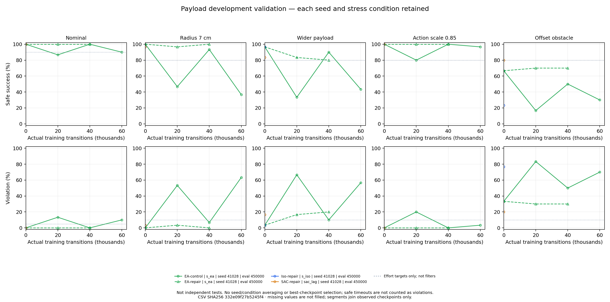

# Panda有限修复：保留原始好父策略与当前开发曲线

本页仅复用已经由训练器生成的30回合开发评测，布局450000起；没有重跑仿真、
共同验证或独立测试。所有结果是seed41028，不是跨训练seed统计。

## 新40K步时的同预算对照

| 条件 | 原分布EA对照安全成功／违规 | 有限半径修复EA安全成功／违规 |
|---|---:|---:|
|标准|100% /0%|100% /0%|
|70mm半径|93.3% /6.7%|100% /0%|
|加宽载荷|90% /10%|80% /20%|
|执行0.85|100% /0%|100% /0%|

有限半径训练在已见开发半径上较好保留表现，但加宽载荷仍退化，不是所有条件都改善。
前40K累计训练违规：原对照122，修复206；不能据此称修复降低了训练安全开销。
新20K时原对照的半径安全成功46.7%、修复96.7%；原对照40K恢复后又在60K下降到36.7%，
所以完整曲线、多个好快照和弱节点都保留，不要求最后一个节点或所有节点稳定。

## 原来就好的父策略不被覆盖或贬为失败

EA240K父快照的原开发结果为标准/70mm/加宽/执行安全成功100%/100%/96.7%/100%。
因此不能把“修复好于某些继续训练节点”写成“修复已胜过原有好父策略”。原父状态、
旧独立结果和模型身份继续保留。两条新分支同源、同新增预算，父策略本身不是从头重建。

图的0步是真实的历史父快照开发评测，不是补造的零点。Iso120K与SAC300K的0步也
只表示原有父策略；它们的新训练仍排队，没有用0值填充尚未产生的后续结果。
不同父策略历史训练年龄不相同，横轴统一为此次新增步数。

遗留offset条件只按原名保留供诊断，不支持合法替代路线或同伦覆盖结论。
严格共同验证仍等待四条100K真实完成；新最终测试保持未打开，不依据此页挑最终结论。
原始开发JSON保存在本地`robot_gap_v3_sources/panda_development`和4080数据盘；
`development_curve.csv`及`receipt.json`绑定每份源文件的SHA。
