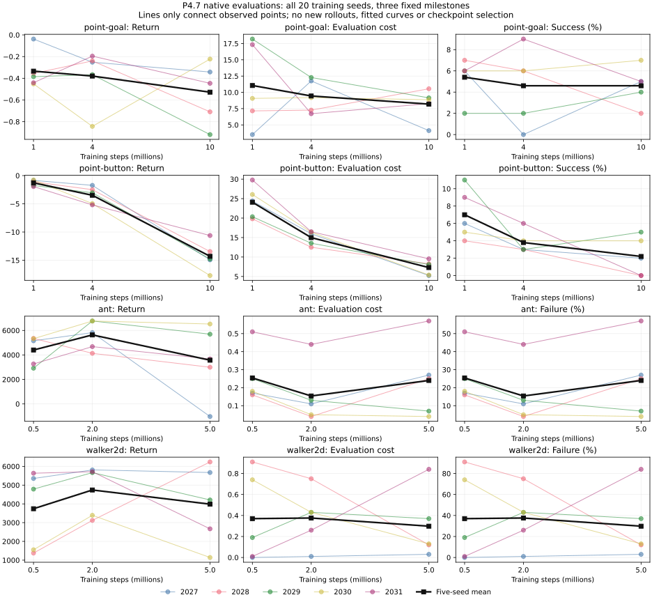

# P4.7 现有结果诊断：保留结果，不追加训练

按用户 2026-11-05 的选择：保留 20 组现有结果，先诊断效果，不追加训练。
本次仅整理已有 JSON/CSV，不加载模型，不增加环境交互、评测或配置搜索。
历史原始检查点缺口仍然存在，严格验收仍未通过；以下不是完整可复现性认证。

## 结论

**当前最值得关注的不是训练还没跑够，而是长训练中的任务性能退化、
Point 任务方向约束的有效强度偏弱，以及 reward critic 的异常数值尺度。**
这些是现有曲线、日志和冻结实现支持的诊断线索，不是已经通过消融证明的因果结论。
不把“平均成本下降”单独解释为方法成功，也不把问题简单归因于 GPU 使用率。

## 1. 完整预设评测曲线：延长训练没有稳定改善任务表现

已整理 4 环境 × 5 训练 seeds × 3 预设里程碑，共 **60 个已有评测点**。
每点评测为 5 个固定评测 seeds × 20 episodes；统计单位仍是 5 个训练 seed。
表中数值为训练 seeds 的均值，CVaR 为每个训练 seed 的 CVaR 再取平均。

| 环境 | 训练步数 | Return | 任务指标 | Evaluation cost | CVaR-20 |
|---|---:|---:|---:|---:|---:|
| PointGoal | 1M | -0.334 | Success 5.4% | 11.050 | 54.82 |
| PointGoal | 4M | -0.379 | Success 4.6% | 9.442 | 46.71 |
| PointGoal | 10M | -0.528 | Success 4.6% | 8.192 | 38.11 |
| PointButton | 1M | -1.286 | Success 7.0% | 24.078 | 86.22 |
| PointButton | 4M | -3.485 | Success 3.8% | 14.978 | 49.35 |
| PointButton | 10M | -14.302 | Success 2.2% | 7.292 | 30.77 |
| Ant | 0.5M | 4403.20 | Failure 25.4% | 0.254 | 0.91 |
| Ant | 2M | 5635.33 | Failure 15.4% | 0.154 | 0.53 |
| Ant | 5M | 3572.18 | Failure 24.0% | 0.240 | 0.71 |
| Walker2d | 0.5M | 3741.57 | Failure 37.0% | 0.370 | 0.60 |
| Walker2d | 2M | 4741.20 | Failure 37.6% | 0.376 | 0.81 |
| Walker2d | 5M | 3986.00 | Failure 29.8% | 0.298 | 0.68 |

图中连线仅连接三个已观测点，不是密集评测、拟合曲线或置信区间。

- PointButton 的 **5/5 seeds** 从 1M 到 10M 都是 return 和 success 下降。
  成本下降与任务退化同时出现，不是稳定 Pareto 改善。
- PointGoal 的成功率始终很低，4/5 seeds 的最终 return 低于 1M。
- Ant 的 5/5 seeds 在 5M 的 return 均低于 2M。其中 seed 2027
  为 `5823.82 → -1027.77`，但不能只删掉这个差 seed：其余四个也回落。
- Walker2d 有异质性：seed 2028 后期明显改善，另外四个 return 回落。
  不能概括成“所有任务都越训越差”，也不能只挑改善的 seed。

这些比较使用相同预设训练 seed 和评测协议，但没有配套 C0/C1 对照，
不能证明退化必然由某个安全组件引起。恢复中断和跨设备变化也是未排除因素。
现有预算已完整跑完；不据此追溯改变提前停止规则或挑选最好检查点替代最终结果。

## 2. Point 不是同一种行为问题

| 已有评测诊断，五 seed 均值 | PointGoal 1M → 10M | PointButton 1M → 10M |
|---|---:|---:|
| 每 episode 路径长度 | 2.47 → 3.30 | 5.27 → 20.00 |
| 起终点位移 | 1.00 → 1.16 | 2.26 → 15.25 |
| 平均动作范数 | 0.351 → 0.528 | 0.482 → 0.783 |
| Step stall ratio | 45.8% → 38.9% | 14.5% → 4.6% |
| Success | 5.4% → 4.6% | 7.0% → 2.2% |

PointGoal 有明显低位移/停滞特征，PointButton 则越来越能移动，但更少完成任务。
后者不宜解释为“安全约束让策略完全不动”。其净位移和路径都增加，
更符合无效移动/偏离任务目标的行为线索；仅凭汇总日志不能定位具体轨迹或断言绕圈。

## 3. 方向机制已配置启用，但 Point 的有效可靠度很低

最终高风险 20% 样本上：

| 环境 | 安全权重 | 总可靠度 | V_N / V_T |
|---|---:|---:|---:|
| PointGoal | 0.8210 | 0.02896 | 0.9616 |
| PointButton | 0.9622 | 0.00707 | 0.9908 |
| Ant | 0.9672 | 0.13200 | 0.8716 |
| Walker2d | 0.8088 | 0.21364 | 0.7839 |

Point 的高风险权重并不接近零，但可靠度很低，法向/切向方差比仍接近 1。
冻结实现中的可靠度为：

\[
r_C=w_C\,\frac{\|\nabla_a(\bar Q_C/S_C)\|}
{\|\nabla_a(\bar Q_C/S_C)\|+g_0}
\exp(-\text{normalized disagreement}/\eta).
\]

注意：归一化尺度 \(S_C\) 对 Point 为 10，对 Ant/Walker 的未来失败概率为 1，
不是用其为零的成本预算作除数。
不能把不同任务的原始梯度大小直接等价比较。

各最终 segment 最后至多 500k 步的训练批次日志进一步显示：

| 环境 | Gradient reliability | Ensemble reliability | 总 reliability | 方向 loss |
|---|---:|---:|---:|---:|
| PointGoal | 0.1056 | 0.9117 | 0.01151 | 0.000218 |
| PointButton | 0.0248 | 0.9794 | 0.00242 | 0.000268 |
| Ant | 0.5357 | 0.3697 | 0.12894 | 0.006636 |
| Walker2d | 0.5898 | 0.6573 | 0.20269 | 0.008484 |

**对 Point，梯度可靠度是较弱的因子，而不是 ensemble 一致性差。**
但这里是训练批次统计，上一表是高风险评测子集，不能把两表的均值相乘
来“重算”可靠度。日志也不能区分成本 critic 局部梯度平坦、输出饱和、
归一化尺度不适配及其他分布效应；这些仍是未决机制。

这支持先关注实际可靠度/梯度信息，而不是直接继续细扫 `lambda_dir`。
方向 loss 的标量较小不等于其策略梯度必然可以忽略，本次没有测量组件梯度贡献。

源码也排除了两个容易误判的解释：

- `W2` 和 `training_geometry_enabled=false` 是旧 W3 几何开关状态；
  unified Q-cost 分支绕过该旧开关，不能据此宣称 P4.7 从未运行。
- unified Q-cost 的 `calibration_reliability` 固定为 1，不能把概率 critic
  的 Brier/AUROC 变化当作关闭方向扩散的直接开关。

实现依据：[STAR 冻结实现](../../omnisafe/algorithms/off_policy/star.py)、
[成本几何与方向损失](../../omnisafe/models/safety/distributional_backend.py)。

## 4. 全局安全乘子很大，reward critic 数值尺度值得优先审查

同一最终 segment 日志窗口中：

| 环境 | 全局安全乘子均值 | Reward Q absolute-max 日志均值 | Reward TD 均值 |
|---|---:|---:|---:|
| PointGoal | 99.84 | 113,376 | 325.64 |
| PointButton | 89.86 | 153,943 | 106.80 |
| Ant | 4.33 | 1,584 | 4.15 |
| Walker2d | 17.39 | 895 | 3.32 |

这些 Q 数字是原生 `Critic/RewardQAbsMax` 字段在日志 epoch 和训练 seed 上的均值，
**不是所有访问状态的平均 Q，更不是正向过估计量**；TD 是双 reward critic
相对其 bootstrapped target 的平均绝对误差。不同任务的 reward 尺度和目标不同，
不能仅以此证明发散或错误。

但 Point 上很大的 Q/TD，结合低成功率和后期任务退化，是比“再给更多 GPU 时间”
更值得优先解释的数值信号。当前检查没有定位到一个已证实的单行 bug。

冻结 actor 目标为
`(energy_multiplier * energy - reward_Q + safety_multiplier * cost_Q) / (1 + safety_multiplier)`。
因此乘子在约 90–100 时，reward_Q 的显式系数仅约 1%，cost_Q 系数约 99%。
这是实现上的系数事实，不是对实际 actor 梯度大小或退化因果关系的证明。
PointGoal 最后窗口约 46.2% 日志 epoch 恰好触及 100 的上界；PointButton 为
5.0%，不能把两者都写成“始终卡死在上界”。

另一个反例是 PointButton：成本预测 MAE 从 1M 的 10.54 改善到 10M 的 1.58，
概率 Brier skill 也从 0.421 改善到 0.743，但 success 更低。
所以不能笼统归因为“所有 critic 都没有学会”；预测误差改善、局部可用梯度
和任务优化是否有效是不同问题。

## 5. 当前处理决定与证据边界

执行决定：保留全部 seed 和最终结果，不新增训练、不重新评测、不改冻结方法，
也不进行权重搜索。下一次若另行讨论修改，应先围绕 reward 学习稳定性、
真实任务驱动信号及可靠度尺度建立明确假设，而不是无边界追加算力。
这仅是后续讨论优先级，不是实验启动授权。

本次没有重复最终严格审计。早期原始检查点缺失与多次迁移路径限制依旧保留；
它们是可复现性缺口，不是已证明的低成功率成因。

Ant-2031 的 0.5M/2M 评测在当前终态容器中缺失，但在已发布的原始备份中找回，
SHA-256 分别为 `634c3d...0570`、`85841f...2b46`，与已有 4T manifest 对应。
它们只加入本地描述性曲线包，并未伪装成已修复远程容器或恢复了历史 checkpoint。

原始 progress CSV 分 segment 保留，不拼接或丢弃恢复重叠尾部来假造一条
“已验证完整训练轨迹”。日志窗口每个 seed 单独统计，再跨 seed 等权取平均。
大部分窗口有 100 个 epoch；Ant-2027/2031 最终 segment 只有 50/30 个，均明确保留。

## 数据与复现脚本

- [60 个预设评测点、原始文件清单及哈希](shapo_p47_four_env_artifacts/partial_milestones/native_learning_curves_all20_20261105/summary.json)
- [逐 seed、逐里程碑 CSV](shapo_p47_four_env_artifacts/partial_milestones/native_learning_curves_all20_20261105/per_training_seed_milestones.csv)
- [最终 segment 与评测诊断数据](shapo_p47_four_env_artifacts/partial_milestones/native_effect_diagnosis_20261105/summary.json)
- [数据收集脚本](shapo_p47_four_env_artifacts/operations/20261105/collect_native_learning_curves_20261105.py)、[日志诊断脚本](shapo_p47_four_env_artifacts/operations/20261105/diagnose_native_logs_20261105.py)、[绘图脚本](shapo_p47_four_env_artifacts/operations/20261105/plot_native_learning_curves_20261105.py)
- [最终预算结果汇总与严格审计失败记录](P4_7_ALL20_NATIVE_RESULTS_20261105.md)
