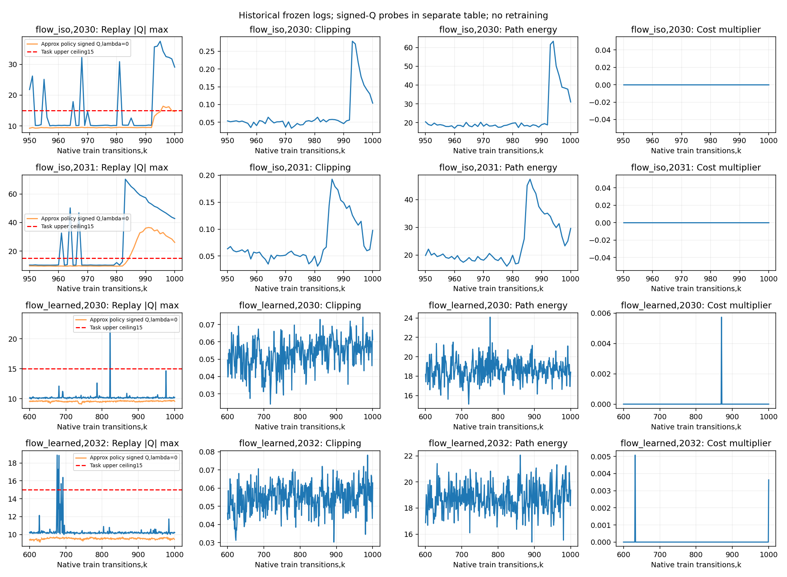

# EA-STAB v2 baseline diagnosis

Evidence baseline: `1dc1f2945bb01ace08500147659a73623f30d977`.
Diagnosis implementation: `f476851a644199b8345157fa0c36a83c093dc01a`.
No historical primary outcome or checkpoint was changed. This is post-hoc
attribution, not a new final score or evidence that the proposed repair works.

## Completed bounded probes

All three historical methods and all three seeds were inspected at600k/1M:
two fixed128-sample batches per checkpoint,36 probes total. Both checkpoints
use the same explicitly labelled final1M replay batches. The600k probes are
retrospective common-state comparisons, NOT native600k replay or continuation.
There were0 optimizer updates and0 new training transitions.

The signed-Q entries below average the two batches. Upper-bound fractions
use each state's `5*min(||EE-goal||,1)+10`, not an arbitrary log clamp.

| Historical checkpoint | Replay-action min-Q mean | Policy-action min-Q mean | Replay / policy above state upper bound | Reward / energy actor gradient norm | Cost multiplier |
|---|---:|---:|---:|---:|---:|
| Iso2030,600k | 9.296 | 9.404 | 0% /0% | .623 /.151 | 0 |
| Iso2030,1M | 16.516 | 17.980 | 94.53% /96.48% | 1.307 /.550 | 0 |
| Iso2031,600k | 8.402 | 9.274 | 0% /0% | .867 /.119 | 0 |
| Iso2031,1M | 26.798 | 28.702 | 93.36% /96.09% | 2.614 /1.481 | 0 |
| Learned2030,600k | 9.485 | 9.538 | 0% /0% | 1.056 /.153 | 0 |
| Learned2030,1M | 9.559 | 9.577 | 0% /0% | .148 /.100 | 0 |

This corroborates a positive value-learning pathology in the two failed Iso
seeds. It is not confined to newly sampled Actor actions: replay actions are
also overestimated. Policy-action values are still higher. The weighted cost
gradient is exactly zero for those Iso checkpoints, so a large active dual
cannot explain their particular final stalls. Reward-gradient norms exceed
energy-gradient norms in these fixed probes; norms alone do not prove a
complete causal explanation. SAC and Learned final probe values are around
9.5-9.9 rather than the anomalous Iso range. All signed values, ranges,
component gradient cosines and failure-sample counts are retained in
[critic_probes.csv](baseline-f476851/critic_probes.csv).

The upper bound's assumptions were checked in the baseline environment:
clipped distance-potential difference with coefficient5, one terminal success
bonus10, no other positive bonuses, nonpositive charges, true horizon/first
violation termination and gamma=.99. Discounted potential terms telescope to
at most the initial potential; nonnegative future flow-energy penalties cannot
increase the return. This is a diagnostic bound, NOT a new target projection.
The native-log signed-Q reconstruction is labelled approximate because logged
alpha is post-update; the checkpoint probes above read signed Q directly.

## Actor/margin cross intervention:320 episodes, not primary replacement

Two representative historical Learned seeds2030/2032, Actor600k/1M crossed
with margin600k/1M; nominal/radius8cm,20 fixed episodes each. The same sampling
seeds are paired within each training seed. These diagnostic episodes reuse
historical layout identities, not the new version's unseen final test layouts.

Cells below are safe success / violation counts out of20.

| Seed | Actor | Nominal,margin600k | Nominal,margin1M | Radius8cm,margin600k | Radius8cm,margin1M |
|---|---|---:|---:|---:|---:|
| 2030 | 600k | 20 /0 | 20 /0 | 20 /0 | 20 /0 |
| 2030 | 1M | 17 /3 | 17 /3 | 4 /16 | 4 /16 |
| 2032 | 600k | 20 /0 | 20 /0 | 19 /1 | 19 /1 |
| 2032 | 1M | 20 /0 | 20 /0 | 7 /13 | 8 /12 |

Changing the late margin back to600k does not rescue the late Actor in these
small tests. In2030 the outcomes are identical under both margins; in2032
the late margin slightly improves the late Actor's radius result. This argues
against attributing the observed regression solely to late margin drift.
It does not prove that margin extrapolation or geometry location is accurate,
and20 episodes are not a population-level causal estimate. Full diagnostic
records and capped times remain in [cross_evaluations.csv](baseline-f476851/cross_evaluations.csv).

All probes/cross tests completed normally in19.49s on4080. They consumed
5154 new physical evaluation transitions,0 training transitions,0 optimizer
steps and0 oracle direction queries. These physical queries are reported
separately rather than called zero environment cost. No large historical
checkpoint/replay was copied back to the host.

## What remains unproven and next action

The replay margin MAEs are small (Learned2030 final .000572m overall,
.000599m near the boundary), but this is a fitted replay distribution, not
an episode-isolated radius8cm validation set. The64-state geometry/true-risk
probe is still pending and will be reported separately; these replay numbers
do not substitute for it. No boundary-priority batch or BCE/PID revision is
enabled merely because it was listed as an option.

First candidate remains the SAME lower Actor learning rate and Huber reward
critic for all S-Iso/S-Local/S-EA; Local/EA share EMA/ramp. These are hypotheses,
not validated fixes. No new development training has started at this capture.
The update-delay rationale is consistent with
[Fujimoto et al.,ICML2018](https://proceedings.mlr.press/v80/fujimoto18a.html),
which does not guarantee this project's proposed settings will work.

Historical9M results and all negative outcomes remain unchanged. The diagnosis
does not authorize selecting a favorable historical600k checkpoint as final.
